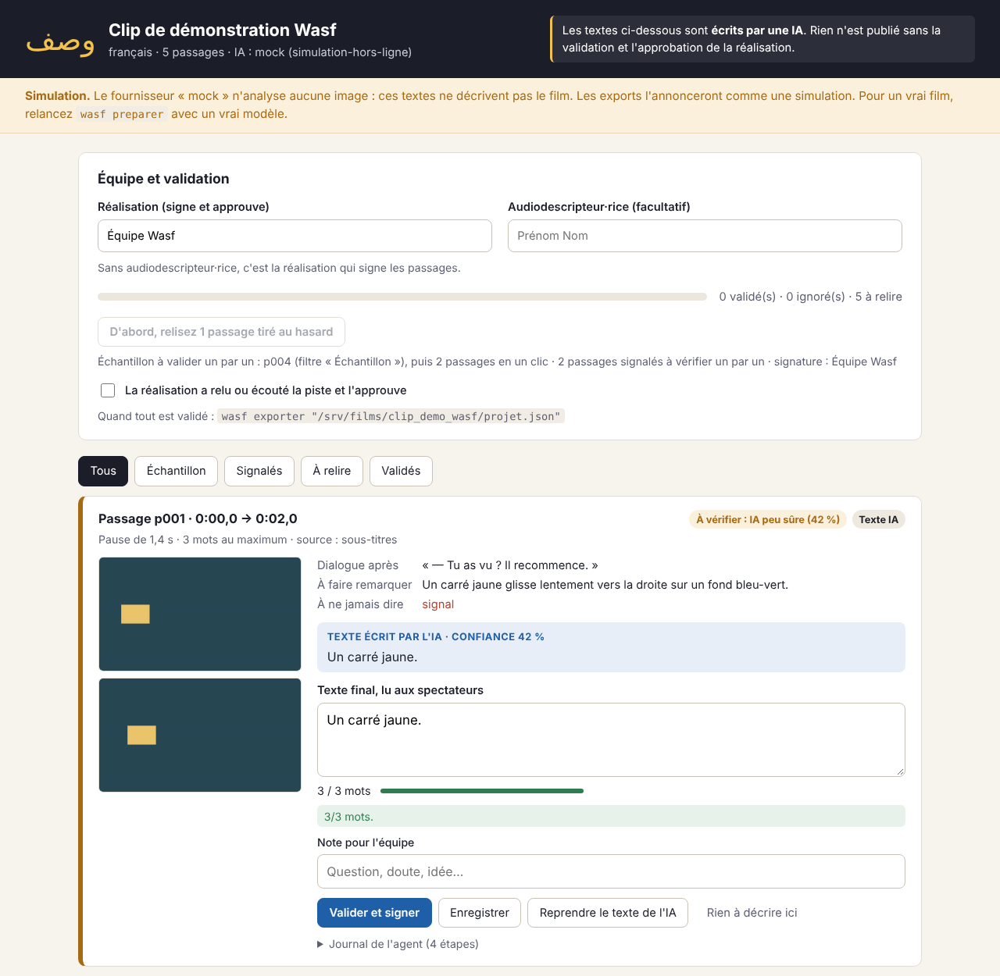

# Wasf · وصف

**Une seule lecture du film, deux pistes d'accessibilité : l'audiodescription pour les personnes
aveugles et malvoyantes, les sous-titres dynamiques pour les personnes sourdes et malentendantes.
L'IA écrit, la réalisation garde la main.**

Wasf (« description » en arabe) rend les films tunisiens et francophones accessibles en
**arabe**, en **derja** et en **français**, à deux publics :

| Piste | Pour qui | Ce qu'elle apporte | Où en est-elle |
| --- | --- | --- | --- |
| **Audiodescription** | Personnes aveugles et malvoyantes | Ce qu'on voit, dit à voix haute dans les silences du film | **Fonctionne** : c'est le code de ce dépôt |
| **Sous-titres dynamiques** | Personnes sourdes et malentendantes | Ce qu'on entend, et comment c'est dit : qui parle, à quel volume, d'où vient le son | **En préparation** : la conception est [décrite plus bas](#sous-titres-dynamiques-en-préparation), le code reste à écrire |

Pour l'audiodescription, l'IA écrit toute la piste ; Wasf signale les passages où elle doute ; la
réalisation les vérifie, valide les autres en un clic et approuve la piste. Un·e
audiodescripteur·rice peut relire en plus, si la production le souhaite. Les sous-titres
dynamiques passeront par la même relecture, la même signature et le même rapport de transparence.

> Projet du hackathon **IA Éthique 360** : Junior Entreprise INSAT et Organisation internationale
> de la Francophonie (OIF), Forum INSAT Entreprise, novembre 2026.



---

## Le problème

> « Les personnes aveugles, malvoyantes, sourdes et malentendantes en Tunisie ne peuvent pas suivre
> pleinement les films tunisiens : il leur manque une audiodescription, ou des sous-titres qui
> disent aussi ce qu'on entend, en arabe ou en derja. Cela les exclut d'une partie de leur propre
> culture. »

**Comment nous avons repéré le problème.** Le constat repose sur des chiffres publics (INS, OMS),
des études sur l'audiodescription en arabe publiées de 2020 à 2025, les catalogues des
plateformes, et des témoignages publiés par des personnes concernées et leurs associations. Chaque
source est liée ci-dessous.

**Ce que disent les chiffres et les études**

- **Combien de personnes** : au recensement 2024, 1,0 % des 11,27 millions de personnes de
  5 ans et plus ont beaucoup de difficultés à voir ou ne voient pas, soit environ 113 000
  personnes ; 7,1 % ont au moins quelques difficultés. Pour l'audition, 0,7 % ont beaucoup de
  difficultés à entendre ou n'entendent pas, soit environ 79 000 personnes ; 3,7 % ont au moins
  quelques difficultés
  ([INS, bulletin de septembre 2025](https://www.ins.tn/sites/default/files-ftp3/files/2025-09/PROD-Handicap-BULLETIN-FR.pdf)).
- **Le vieillissement** : 16,9 % des Tunisiens ont 60 ans ou plus
  ([INS, recensement 2024, repris par Idaraty](https://www.idaraty.tn/public/fr/rapports/ins-recensement-2024)),
  et dans le monde, plus de 25 % des plus de 60 ans ont une perte auditive incapacitante
  ([OMS, février 2024](https://www.who.int/entity/mediacentre/factsheets/fs300/fr/index.html)) :
  un public qui grandit avec l'âge de la population.
- **Ce qui existe en arabe** : selon une étude de 2025, Netflix est la seule plateforme qui
  propose de l'audiodescription pour des contenus arabes, et sur quelques titres ; faute de loi,
  la télévision et le cinéma n'en proposent pas régulièrement
  ([El-Taweel et al., EFIT, 2025](https://doi.org/10.7203/efit.2.30317)). Sur les plateformes
  américaines : 64 titres audiodécrits en arabe ([ACB, novembre 2024](https://adp.acb.org/foreignad.html)).
- **Les films tunisiens** : six films tunisiens sont arrivés sur Netflix en 2020 (Beauty and
  the Dogs, Dachra, Noura's Dream, A Son) et en 2023 (Black Medusa, Streams). Leurs annonces
  citent les sous-titres, jamais l'audiodescription
  ([Al Bawaba, 2020](https://www.albawaba.net/editors-choice/netflix-set-broadcast-44-great-arabic-movies-1363897),
  [MAD Solutions, 2023](https://mad-distribution.film/press/505475622469.php)).
  À confirmer dans le menu Audio de chaque film.
- **Le coût à la main** : décrire un film de 2 heures peut prendre jusqu'à 60 heures de travail
  ([LSMDC, 2015](https://arxiv.org/pdf/1501.02530)).
- **Dialecte ou arabe standard** : deux études de réception menées avec des spectateurs
  aveugles arabophones vont dans des sens différents. Au Qatar, ils préféraient une
  audiodescription en arabe standard mais prenaient plus de plaisir à la version en dialecte ; en
  Jordanie, mélanger arabe standard et dialecte les a gênés (Alnatsheh 2020 et Darwish et al.
  2022, cités par [Journal of Audiovisual Translation, 2025](https://jatjournal.org/index.php/jat/article/view/367)).
  Dans Wasf, la réalisation choisit une seule langue par piste (derja, arabe standard ou
  français), et l'éditeur signale une phrase en arabe standard dans une piste en derja.

**Ce qu'en disent les personnes concernées** *(témoignages publiés, avec leur source)*

- **Mohamed Mansouri**, président d'IBSAR, association tunisienne des personnes aveugles et
  malvoyantes, demande « une culture équitable, inclusive sans distinction aucune ni exclusion »
  (TAP, mai 2025, repris par [Webmanagercenter](https://www.webmanagercenter.com/2025/05/16/546238/ouverture-de-la-7eme-edition-du-festival-international-des-musiciens-et-createurs-en-situation-de-handicap/)).
  IBSAR organise le festival HandyFilms, avec une section de films audiodécrits
  ([FilmFreeway](https://filmfreeway.com/HandyFilms-Tunisia)).
- **Aseel Shaqra**, fondatrice de Hawas en Jordanie, a cherché des films audiodécrits en arabe
  pour des enfants aveugles et n'en a trouvé nulle part dans le monde arabe. Depuis 2019, elle les
  écrit et les enregistre elle-même, et un enfant aveugle donne son avis sur les films
  ([Jordan News](https://jordannews.jo/section_49/section/title_23418)).
- **Ola**, spectatrice sourde en Égypte : avant la plateforme Cinema Deaf, elle devait imaginer
  les dialogues ou demander l'aide de sa fille pour suivre un film
  ([The National, décembre 2023](https://www.thenationalnews.com/arts-culture/film-tv/2023/12/19/egyptian-arabic-movie-subtitles-cinema-deaf-silent-films-hearing-impaired)).
- **Des spectateurs sourds en Égypte** : dans une enquête de 2022 sur une comédie égyptienne
  sous-titrée en arabe standard, un quart des répondants avaient du mal à lire et à comprendre les
  sous-titres ([Egyptian Streets, mars 2023](https://egyptianstreets.com/2023/03/13/translating-sound-towards-an-accessible-cinema-for-egypts-deaf-audiences/)).
  C'est un argument pour des sous-titres dans la langue que parle le film.

## Ce que fait Wasf

La piste d'audiodescription, déjà codée, suit ces étapes :

```
film + sous-titres + intention de la réalisation
        │
        ▼
 1. Repérer les pauses dans les dialogues (sous-titres, ou silences de la bande-son)
 2. Extraire 2 images par pause (768 px max) et 2 juste avant, pendant le dialogue (512 px),
    pour saisir les réactions et ce qui change
 3. L'agent écrit chaque description, guidé par ce que la réalisation veut faire remarquer ;
    il note à part ce qu'il a vu (signes visibles) et ce qu'il suppose (émotions)
 4. L'agent se vérifie : longueur, éléments interdits, répétition du dialogue, émotion affirmée
    ou diagnostiquée → révision ; il signale les passages où il doute
 5. La réalisation vérifie les passages signalés et valide les autres en un clic (éditeur local)
 6. La réalisation approuve la piste complète
 7. Voix (humaine, Azure ar-TN, espeak…) et mixage : le son du film baisse sous la voix
 8. Exports : film audiodécrit avec annonce « écrite par IA », piste audio,
    WebVTT/SRT, rapport de transparence, crédits
```

Ce qui distingue Wasf des outils existants :

- **deux publics servis par une seule lecture du film** : l'audiodescription aujourd'hui, les
  sous-titres dynamiques ensuite, avec les mêmes garde-fous ;
- **la derja et l'arabe** pour les films tunisiens, pas seulement les grandes langues des plateformes ;
- **l'intention de la réalisation** guide chaque description (ce qu'il faut faire remarquer, ce qu'il ne faut jamais révéler) ;
- **ce que les personnages expriment sans parler** : visages, gestes, posture et leurs
  changements, le signe visible d'abord ; une émotion seulement si des signes l'appuient, jamais
  affirmée avec certitude ni diagnostiquée ;
- **la réalisation garde la main** : l'IA ne publie rien, ses doutes sont signalés, et l'export est
  refusé sans signature ni approbation ;
- **la transparence** : annonce en tête de film, texte de l'IA conservé à côté du texte final,
  rapport chiffré (dont les passages validés en un clic).

## Sous-titres dynamiques (en préparation)

La deuxième piste de Wasf s'adresse aux personnes sourdes et malentendantes. Elle **n'est pas
encore dans le code** : ce dépôt produit aujourd'hui l'audiodescription. Les sous-titres montrés
dans notre vidéo et dans notre présentation sont des maquettes.

Les sous-titres classiques donnent les mots. Ceux de Wasf diront aussi comment ils sont dits, à
partir de la même lecture du film que l'audiodescription.

| Ce qu'on entend | Ce qui s'affichera |
| --- | --- |
| Qui parle, et ce qu'on entend | Le code couleur de la charte française de 2011 : blanc pour la personne qu'on voit parler, jaune pour une voix hors champ, rouge pour un bruit, magenta pour la musique (critère 9, [résumé par Selectra](https://selectra.info/telecom/actualites/marche/sous-titres-tele-couleurs-jaune-rouge-cyan)) |
| Le volume | Une voix forte en majuscules (`TU L'AS LUE ?`), un murmure en plus petit et entre parenthèses (`(non… pas encore)`), un mot qui traîne étiré (`Nooon !`) |
| D'où vient le son | Le sous-titre se place sous la personne qui parle, ou du côté d'où vient le bruit dans le mixage |
| L'arabe et la derja | L'arabe n'a pas de majuscules : le gras et la taille les remplacent |

**On écrit ce qu'on entend, pas ce qu'on suppose.** Wasf n'écrira jamais « (en colère) » ; il
montrera qu'une voix est forte, parce qu'un volume se mesure. Si l'auteur du film veut préciser
une émotion, c'est lui qui l'ajoute, comme pour l'audiodescription.

**Lisible d'abord.** Dans une étude présentée à CHI 2023, 16 participants sourds ou malentendants
ont comparé trois styles expressifs aux sous-titres classiques. Le style qui montrait les émotions
rendait mieux les émotions et l'insistance, avec une perte modérée de lisibilité. Celui qui ne
montrait que la prosodie (volume, hauteur, durée) ne faisait pas mieux que les sous-titres
classiques pour l'insistance ([de Lacerda Pataca et al., 2023](https://doi.org/10.1145/3544548.3581511)).
Notre piste ressemble à ce second style : raison de plus pour tester avant de promettre. Une
étude de 2025 a aussi trouvé que les préférences pour la prosodie varient d'une culture à l'autre
([CuCap, ASSETS 2025](https://www.dgp.toronto.edu/~suhyeon423/publications/cucap/)). Ces études
montrent enfin que les spectateurs apprécient qu'on leur montre les émotions : dans Wasf, c'est
l'auteur qui les ajoute, pas l'IA. Nous garderons donc peu d'effets, avec une version classique
au choix, et ce sont des tests avec des spectateurs tunisiens sourds et malentendants qui diront
quels effets aident vraiment.

**Le texte de départ** : les sous-titres du film quand ils existent ; sinon, une transcription
automatique corrigée par la relecture, car la reconnaissance de la derja reste imparfaite.

**Ce qui existe déjà et servira** : la lecture des sous-titres du film (SRT ou WebVTT) et de sa
bande-son, l'éditeur de relecture, la signature et l'approbation de l'auteur, le rapport de
transparence.

**Ce qui reste à construire** :

1. mesurer le volume de chaque réplique par rapport à la voix habituelle du personnage ;
2. trouver de quel côté vient chaque son dans le mixage stéréo ;
3. repérer les bruits et la musique entre les répliques, que la relecture nomme ou corrige ;
4. exporter des sous-titres stylés (couleur, taille, position) et une version classique ;
5. tester les styles avec des personnes sourdes et malentendantes, en Tunisie.

**Une limite assumée** : les personnes sourdes qui signent ont besoin de la langue des signes
tunisienne. C'est une piste à construire avec les associations.

## Les données

Wasf s'appuie sur des modèles d'IA déjà entraînés et les guide, film par film, avec les images,
les sous-titres et les notes de la réalisation. Aujourd'hui, Wasf **n'entraîne aucun modèle**, et
il n'en entraînera **jamais sur le film d'un client**. Il n'utilise ni film ni audiodescription
d'autrui sans accord, ni données collectées sur le web.

Les sous-titres dynamiques pourront demander d'ajuster un modèle, par exemple pour mieux
reconnaître la derja ou les bruits d'un film. Ce sera seulement avec des données dont les auteurs
ont donné leur accord écrit, ajoutées au tableau ci-dessous avant tout entraînement.

- **Pendant l'usage** : pour un film dont le producteur a donné son accord, Wasf envoie à un
  modèle déjà entraîné quatre images réduites par pause (deux pendant, deux juste avant), les
  sous-titres et les descriptions qui précèdent la pause, la réplique qui la suit et les notes de
  la réalisation. Rien d'autre, jamais le film entier.
- **Pour le style** : les exemples du fichier d'intention sont écrits par l'équipe, ou par un·e
  audiodescripteur·rice avec son accord écrit.
- **Pour la démonstration** : `wasf demo` fabrique avec FFmpeg un clip de 30 secondes (formes de
  couleur, mire, sons), ses sous-titres et son fichier d'intention. Aucun droit de tiers.
- **Pour mesurer la qualité** : chaque correction humaine est conservée à côté du texte de l'IA ;
  le rapport de transparence en tire la part du texte réécrite et le nombre de passages validés
  en un clic.
- **Limite** : nous ne connaissons pas les données d'entraînement des modèles utilisés ; c'est une
  raison de plus pour que la réalisation garde la main sur ce qui est publié.

**Tableau des données**

| Donnée | Source | Licence | Consentement | Date de collecte |
| --- | --- | --- | --- | --- |
| Le film à décrire et ses sous-titres | La production, qui détient les droits | Celle du film : Wasf n'en tire aucun droit et n'entraîne rien dessus | Accord du producteur obligatoire : sans lui, `wasf preparer` refuse le film. Sa référence (courriel, contrat) passe dans le rapport et les crédits | L'historique de `projet.json` date la préparation, l'approbation et chaque export |
| Les images envoyées au modèle | Extraites du film : quatre images réduites par pause | Celle du film | Couvertes par l'accord du producteur. Avec Ollama, elles ne quittent pas l'ordinateur | À la préparation (historique de `projet.json`) |
| Le fichier d'intention | La réalisation | Celle du film | Écrit par la réalisation elle-même | À la préparation (historique de `projet.json`) |
| Le journal des appels (`appels.jsonl`) | Écrit par Wasf, une ligne par appel au modèle | MIT, comme le code | Sans objet : ni clé, ni consigne, ni image, seulement l'étape, le modèle, les jetons, la durée et le résultat | À chaque appel |
| Les exemples de style | L'équipe, ou un·e audiodescripteur·rice | Celle de leur auteur·rice | Accord écrit de l'auteur·rice | Date de l'accord écrit |
| Les voix enregistrées (moteur « humain ») | Les personnes qui prêtent leur voix | Accord d'utilisation écrit | Accord de chaque personne enregistrée | Date de l'enregistrement |
| Les voix de synthèse | Azure, espeak-ng, ou une voix Piper choisie par l'utilisateur | Conditions de Microsoft ; GPL v3 pour espeak-ng ; licence propre à chaque voix Piper | Sans objet | Sans objet |
| Les listes de mots en arabe et en derja (`wasf/emotions.py`) | Écrites par l'équipe | MIT, comme le code | Sans objet | Novembre 2026 |
| Le clip de démonstration (`wasf demo`) | Fabriqué par FFmpeg sur l'ordinateur | MIT | Sans objet : personne n'est filmé | À chaque lancement |
| Les modèles d'IA (Gemini, Claude, GPT, modèles d'Ollama) | Leurs fournisseurs | Conditions de chaque fournisseur | Wasf ne les entraîne pas ; leurs données d'entraînement nous sont inconnues | Inconnue |
| Les voix de notre vidéo de présentation | Des membres de l'équipe | Accord des membres | Chacun a enregistré sa propre voix | Novembre 2026 |
| Les deux extraits d'ouverture de notre vidéo | Deux vidéos publiées sur YouTube, en anglais : [extrait 1](https://youtu.be/B9v3zkkx-iw) et [extrait 2](https://youtu.be/xmo3_URTIlg), avec leur lien à l'écran | Celle de leurs auteurs : courts extraits, avec leur source | Sans objet : vidéos déjà rendues publiques par leurs auteurs ; sous-titres français écrits par l'équipe | Novembre 2026 |
| Les chiffres et témoignages de ce README | Sources publiées, liées dans le texte | Courtes citations, avec leur source | Témoignages déjà rendus publics par leurs auteurs ou par la presse | Consultés en novembre 2026 ; date de publication donnée avec chaque source |

**Le refus des ayants droit.** Wasf ne s'appuie pas sur l'exception de fouille de textes et de
données (directive (UE) 2019/790, art. 4) : il ne fouille pas le web, n'entraîne aucun modèle sur
les films qu'il traite, et ne traite un film qu'avec l'accord de son producteur. Sans cet accord,
Wasf refuse le film. Pour les modèles généralistes mis sur le marché européen, c'est à leurs fournisseurs d'avoir une
politique de droit d'auteur et de publier un résumé de leurs données d'entraînement (AI Act,
art. 53). Avec un fournisseur en ligne, lisez aussi l'avertissement sur les offres gratuites
dans [Choisir le modèle d'IA](#choisir-le-modèle-dia).

## Durabilité et énergie

Faire tourner une IA consomme de l'électricité : un peu sur l'ordinateur qui lance Wasf, et
surtout dans les centres de données du fournisseur quand on choisit un modèle en ligne. Wasf
mesure ce qu'il peut, dit ce qu'il ne peut pas mesurer, et limite le calcul dès sa conception.

**Ce que Wasf mesure.** À chaque préparation et à chaque export, il note la durée et le temps de
calcul. Si CodeCarbon est installé (`pip install -e ".[energie]"`), il ajoute une estimation de
l'énergie consommée par l'ordinateur, en kWh, et des émissions en grammes de CO₂, calculées avec
le mix électrique tunisien. Ces mesures sont écrites dans `projet.json` et dans
`rapport_transparence.json` (code : `wasf/energy.py`). Le rapport dit aussi ce que la mesure ne
couvre pas (`energie_portee`) et compte les appels au modèle, avec images ou en texte seul
(`appels_au_modele`).

**Ce qu'il ne peut pas mesurer.** La consommation des serveurs d'un fournisseur en ligne (Gemini,
Claude, GPT) ne lui est pas accessible. Comme ordre de grandeur, Google estime qu'une requête texte
médiane à Gemini consommait 0,24 Wh en mai 2025, entraînement non compris
([Google Cloud, août 2025](https://cloud.google.com/blog/products/infrastructure/measuring-the-environmental-impact-of-ai-inference)).
Les requêtes de Wasf contiennent aussi des images : leur coût réel n'est pas publié. Avec Ollama,
tout le calcul se fait sur l'ordinateur et CodeCarbon le mesure en entier : ce n'est pas
forcément plus sobre, mais c'est mesurable.

**Ce que Wasf fait pour consommer moins.**

- Il n'entraîne aucun modèle aujourd'hui : l'entraînement coûte beaucoup d'énergie. Si un
  ajustement devient utile, son coût en énergie sera mesuré et publié ici.
- Il n'envoie jamais le film entier : quatre images réduites par pause (768 px au plus, 512 px
  pour celles d'avant la pause).
- Les révisions se font en texte seul, sans renvoyer les images.
- Le contexte de l'histoire vient des sous-titres et des descriptions déjà écrites, sans requête
  de plus (`wasf/story.py`).
- La simulation `mock` sert aux tests et aux démonstrations : aucun appel à un modèle.

**Ce qui reste à faire.** Mesurer une préparation complète sur un vrai film avec un vrai modèle,
en ligne et avec Ollama, et publier ici les chiffres obtenus.

**Les textes de référence.** L'annexe XI de l'AI Act demande aux fournisseurs de modèles
généralistes de documenter l'énergie consommée par leurs modèles, connue ou estimée. La
Recommandation de l'UNESCO sur l'éthique de l'IA (2021) consacre son domaine 5 à l'environnement
et aux écosystèmes.

## Marché et modèle économique

Wasf peut-il devenir viable ? À qui s'adresse-t-il, et comment le faire vivre ? Voici nos
réponses, avec ce que nous savons déjà et ce qu'il reste à vérifier.

### Une offre qui n'existe pas encore en Tunisie

Nous n'avons trouvé aucun outil tunisien qui écrive, avec l'IA, l'audiodescription ou des
sous-titres adaptés pour les films. Les jeunes entreprises tunisiennes de l'accessibilité que nous
avons trouvées répondent à d'autres besoins : l'emploi des personnes sourdes et l'apprentissage
de la langue des signes
([Deaf Square](https://www.wearetech.africa/fr/fils/tech-stars/sonia-kherigi-nasfi-offre-des-services-demploi-et-de-formation-aux-malentendants)),
l'école en langue des signes
([SD Academy](https://www.webmanagercenter.com/2025/08/08/549930/la-tunisie-qui-gagnedou-est-nee-lidee-de-sd-academy-y-a-t-il-une-histoire-personnelle-derriere-ce-projet-engage/)),
ou un appareil qui traduit la langue des signes
([Manu](https://managers.tn/2019/10/18/manu-la-voix-des-personnes-sourdes-et-muettes-remporte-le-prix-orange-summer-challenge/)).

Les versions accessibles de films se font aujourd'hui à la main, au cas par cas : une section de
films audiodécrits au festival HandyFilms, ou des séances pour malentendants et malvoyants dans
le bus-cinéma Cinématdour, qui a donné 528 séances en un an
([AllAfrica, janvier 2025](https://fr.allafrica.com/stories/202501210175.html)). La demande
existe ; l'outil pour y répondre à grande échelle, en derja et en arabe, manque. Notre recherche
a été faite en ligne en novembre 2026 : si un outil nous a échappé, nous l'ajouterons ici.

### À qui s'adresse Wasf

Les **utilisateurs** sont les spectateurs : en Tunisie, environ 113 000 personnes voient très mal
ou pas du tout, et environ 79 000 entendent très mal ou pas du tout (voir
[Le problème](#le-problème)). Les **clients**, ceux qui paient, sont ceux qui fabriquent et
diffusent les films :

| Client | Pourquoi il paierait | Ce qu'il achète |
| --- | --- | --- |
| Producteurs et distributeurs | Ils détiennent les droits et livrent les versions du film. Une version accessible ouvre des séances, des chaînes et des plateformes. En France, depuis 2020, un film doit avoir une audiodescription et des sous-titres SME pour obtenir l'agrément du CNC ([CNC, février 2020](https://www.cnc.fr/professionnels/communiques-de-presse/le-cnc-sengage-pour-le-soustitrage-et-laudiodescription-des-films-francais-a-destination-des-personnes-en-situation-de-handicap_1130744)) : une coproduction franco-tunisienne qui demande cet agrément doit les fournir | La version accessible de chaque film, en derja, en arabe et en français |
| Festivals et cinémas itinérants | Programmer des séances accessibles, comme HandyFilms ou Cinématdour | Les versions accessibles des films programmés |
| Salles de cinéma | Accueillir de nouveaux spectateurs avec des séances régulières. Le parc est petit, 41 salles en 2022 ([Tunisie Numérique](https://www.tunisienumerique.com/infrastructures-cinematographiques-15-gouvernorats-ne-disposent-daucune-salle-de-cinema/)) : les salles comptent comme lieux de diffusion plus que comme premiers acheteurs | Des séances accessibles : la version du film et un moyen de la diffuser (casques, application) |
| Chaînes de télévision et plateformes | Rendre leur catalogue accessible ; en arabe, l'audiodescription reste rare sur les plateformes (voir [Le problème](#le-problème)) | Des versions accessibles pour tout un catalogue |
| Institutions culturelles | Financer l'accessibilité, notamment celle des films du patrimoine | Des projets de mise en accessibilité |

Wasf travaille aussi en arabe standard et en français : le même outil peut servir au Maghreb, au
Moyen-Orient et dans les pays francophones. Les films tunisiens circulent déjà : le bilan 2025 de
l'OIF compte un record de 24 sélections dans de grands festivals internationaux, et les films
tunisiens y figurent parmi les plus remarqués
([Webmanagercenter, janvier 2026](https://www.webmanagercenter.com/2026/01/06/559239/cinema-tunisien-une-annee-2025-exceptionnelle-dans-le-bilan-de-loif-avec-des-selections-record/)).

### Ce que nous vendons

Wasf se vend sur abonnement. Le code reste ouvert (licence MIT) pour que chacun puisse vérifier
ce que fait l'IA ; les clients paient le service qui le fait tourner.

1. **L'abonnement mensuel** à la version hébergée : préparer, relire et exporter en ligne, sans
   rien installer ni gérer de clé d'API. Chaque formule comprend un nombre de minutes de film par
   mois, pour les studios, les chaînes et les plateformes ; un film isolé se paie à la minute.
2. **La version accessible clé en main** : Wasf, puis la relecture par un·e audiodescripteur·rice,
   l'enregistrement des voix et les fichiers aux formats salle, télévision et plateformes.
3. **La formation** des équipes de production à la relecture et à la validation.

**Ouvrir le code ne fait pas perdre de clients.** Un producteur n'achète pas un programme et des
clés d'API : il achète des fichiers prêts à diffuser, vérifiés par un humain. Ceux qui installent
Wasf eux-mêmes, surtout des étudiants, des chercheurs et des associations, lui donnent confiance
et le font progresser.

**Les prix de référence.** En France, une audiodescription faite entièrement à la main coûte de
4 000 à 7 000 € par film
([Association Valentin Haüy, sur AlloCiné](https://www.allocine.fr/article/fichearticle_gen_carticle=18675844.html)),
et une minute de film demande environ une heure de travail
([Handicap.fr](https://informations.handicap.fr/a-100-classiques-cinema-bientot-en-audiodescription-32583.php)).
Aux États-Unis, les prix vont de 15 à 75 $ la minute
([3Play Media](https://www.3playmedia.com/blog/how-much-does-audio-description-cost/)). Wasf vise
la partie la plus longue, l'écriture du premier jet, et garde l'humain pour la vérification et la
voix. Nous ne fixerons notre prix qu'après un pilote : il dépend du temps réellement gagné, que
nous n'avons pas encore mesuré.

**Comment Wasf peut devenir rentable.** Pour nous, un film coûte des requêtes au modèle d'IA, du
temps de relecture, l'enregistrement des voix et l'hébergement. Le premier jet automatique réduit
la partie la plus chère, le temps d'écriture ; le reste se vend comme un service. Un catalogue
rendu accessible crée ensuite des besoins réguliers : nouveaux films, nouvelles langues, nouveaux
supports.

### Comment le faire connaître et le faire vivre

- **Un pilote visible** : une séance accessible d'un film tunisien, avec HandyFilms, Cinématdour
  ou les Journées cinématographiques de Carthage, pour montrer le résultat et mesurer le temps
  gagné.
- **La mention dans chaque film** : les crédits et les sous-titres exportés portent « Généré avec
  Wasf ». Chaque film rendu accessible fait connaître l'outil.
- **Le code ouvert** : le dépôt public donne confiance aux producteurs et attire des
  contributions, par exemple des universités.
- **Les réseaux du cinéma** : le CNCI, et l'UPICA, le syndicat créé en 2025 qui réunit producteurs
  et exploitants de salles
  ([L'Économiste maghrébin, mai 2025](https://www.leconomistemaghrebin.com/?p=625577)).
- **La Francophonie et l'export** : les festivals où circulent les films tunisiens, puis les pays
  arabophones et francophones.
- **Des chiffres publiés** : temps gagné par film, nombre de films rendus accessibles, avis des
  spectateurs.

### Les risques, et notre réponse

| Risque | Notre réponse |
| --- | --- |
| Peu de salles en Tunisie : 41 en 2022, et 15 gouvernorats sans aucune salle | Vendre d'abord aux producteurs, aux distributeurs et aux plateformes, et viser l'export |
| Pas d'obligation légale trouvée en Tunisie, contrairement à la France | Mettre en avant le coût plus bas, les nouveaux publics et les coproductions qui doivent fournir ces versions |
| Qualité pas encore mesurée sur un vrai film | Un pilote avant toute vente, et la relecture humaine obligatoire |
| Dépendance aux fournisseurs d'IA | Plusieurs fournisseurs au choix, et un mode local avec Ollama |
| Des technologies pensées sans les personnes concernées : l'association IChara regrette des outils conçus par des entendants qui ne répondent pas aux besoins des sourds ([AllAfrica, juin 2026](https://fr.allafrica.com/stories/202606230353.html)) | Tester chaque piste avec des spectateurs aveugles et sourds avant de la vendre |

## Démarrage rapide (sans clé d'API)

Prérequis : **Python 3.10+** et **FFmpeg** ([ffmpeg.org](https://ffmpeg.org/download.html), à ajouter au PATH).

```bash
git clone https://github.com/ammaryassine86-ai/Bou-Dinar---Wasf.git
cd Bou-Dinar---Wasf
python -m venv .venv
source .venv/bin/activate            # Windows : .venv\Scripts\activate
pip install -e .

wasf demo demo                       # crée un clip de 30 s, ses sous-titres et une intention
wasf preparer demo/clip_demo.mp4 --intention demo/intention_demo.yaml --sous-titres demo/clip_demo.srt --fournisseur mock
wasf relire demo/clip_demo_wasf/projet.json        # ouvre l'éditeur dans le navigateur
wasf exporter demo/clip_demo_wasf/projet.json --voix-moteur espeak
```

Le modèle se choisit toujours avec `--fournisseur`. `mock` est une **simulation hors ligne** :
il ne regarde pas les images, il reformule les notes de la réalisation, pour tester toute la
chaîne sans clé. L'éditeur l'affiche dans un bandeau et les exports l'annoncent : « Simulation :
aucune image n'a été analysée ». Pour de vraies descriptions, choisissez un modèle ci-dessous.

`wasf preparer` ne remplace jamais un projet existant, pour ne pas effacer une relecture. Pour
repartir de zéro dans le même dossier, ajoutez `--remplacer` : l'ancien projet est gardé dans un
dossier `sauvegarde-…`, où il s'ouvre toujours dans l'éditeur.

**Préparation interrompue.** Le projet est enregistré dès que les pauses et leurs images sont
prêtes, puis après **chaque passage** écrit, d'un seul coup (fichier temporaire forcé sur le
disque, puis remplacement) : une coupure de courant, un plantage ou un Ctrl+C laisse toujours un
`projet.json` entier. Relancez la même commande avec `--reprendre` : les passages déjà écrits ne
sont pas redemandés à l'IA. Quand l'IA a échoué sur certains passages (quota épuisé, erreur
réseau), `--refaire-echecs` refait **seulement** ceux-là, sauf ceux qu'une personne a écrits à
la main depuis. Tant que la préparation n'est pas terminée, l'éditeur est en lecture seule et
l'export est refusé, pour qu'aucune modification ne se perde.

Une erreur qui reviendrait à chaque passage (clé refusée, modèle inconnu, quota du jour ou crédit
épuisé, Ollama éteint) arrête la préparation tout de suite, au lieu d'échouer sur tous les
passages l'un après l'autre. Les passages déjà écrits sont gardés et l'historique dit pourquoi
la préparation s'est arrêtée. Une fois le problème réglé, relancez avec
`--reprendre --refaire-echecs`.

```bash
wasf preparer film.mp4 --intention intention.yaml --sous-titres film.srt --fournisseur gemini --reprendre
wasf preparer film.mp4 --intention intention.yaml --sous-titres film.srt --fournisseur gemini --refaire-echecs
```

**Sous-titres.** Wasf lit l'UTF-8 et l'UTF-16 (avec ou sans BOM), l'arabe en Windows-1256 (le
plus courant pour les fichiers faits sous Windows) ou en ISO-8859-6, et le Windows-1252 (latin) ;
l'encodage trouvé est affiché et gardé dans le projet. Il ne remplace jamais un caractère
illisible par « � » : un fichier qu'il ne sait pas lire l'arrête, avec la marche à suivre
(l'enregistrer en UTF-8). Un fichier qui contient du texte mais aucune réplique minutée l'arrête
aussi. Un fichier vide est seulement signalé : les pauses viennent alors des silences.

## Choisir le modèle d'IA

| Fournisseur | Installation | Configuration | Quand l'utiliser |
| --- | --- | --- | --- |
| `ollama` | [ollama.com](https://ollama.com), puis `ollama pull gemma3` | aucune clé | Films inédits : **les images ne quittent pas l'ordinateur** |
| `gemini` | `pip install -e ".[gemini]"` | `GEMINI_API_KEY` | Pour un vrai film : clé liée à un compte de facturation (voir ci-dessous) |
| `anthropic` | `pip install -e ".[anthropic]"` | `ANTHROPIC_API_KEY` | Claude |
| `openai` | `pip install -e ".[openai]"` | `OPENAI_API_KEY`, ou `--url` pour un serveur local compatible | GPT, LM Studio, llama.cpp |

```bash
wasf preparer film.mp4 --intention intention.yaml --sous-titres film.srt \
     --fournisseur ollama --modele gemma3 --langue aeb
```

Modèles par défaut : `gemini-3.6-flash`, `claude-haiku-5-5`, `gpt-6-luna`, `gemma3`. Les noms
changent souvent : vérifiez la liste de votre fournisseur et passez-le avec `--modele` (ou les
variables `WASF_GEMINI_MODEL`, `WASF_ANTHROPIC_MODEL`, `WASF_OPENAI_MODEL`, `WASF_OLLAMA_MODEL`).
Un fournisseur peut rediriger un ancien nom vers un nouveau modèle : le rapport de transparence
et les crédits nomment le modèle que l'API dit avoir utilisé, pas seulement celui demandé.

**Ce que coûte une préparation.** Chaque appel au modèle laisse une ligne dans `appels.jsonl`, à
côté de `projet.json` : l'étape, le passage, le modèle demandé et celui qui a répondu, les jetons
envoyés et reçus quand l'API les donne (sinon `null` : jamais estimés), la raison de fin, la durée
et le résultat. Ni clé, ni consigne, ni image. À la fin, `wasf preparer` en donne le total. Une
reprise (`--reprendre`) ajoute ses lignes sans redemander un passage déjà écrit. Avec Claude, une
réponse fait au plus 1 024 jetons, réglables avec `--jetons-max` ; une réponse coupée est signalée
et notée au journal.

**Attention aux offres gratuites.** Avec un fournisseur en ligne, les images extraites et le texte
sont soumis à ses conditions. Chez Gemini, par exemple, les contenus envoyés avec l'offre gratuite
servent à améliorer les produits de Google et peuvent être lus par des relecteurs humains ; avec une
offre payante, ils ne servent pas à cela ([conditions de l'API Gemini](https://ai.google.dev/terms)).
Pour un film réel, utilisez une offre payante qui exclut cet usage, ou Ollama : sinon, la promesse
« le film n'entraîne aucun modèle » ne tient plus.

L'offre gratuite limite aussi le nombre de requêtes par minute et par jour. Quand Gemini répond
« trop de requêtes » pour la minute, Wasf attend le délai qu'il indique et réessaie (deux fois au
plus) ; de même, après une courte pause, quand les serveurs de Google sont surchargés ; quand le quota du jour est épuisé, il arrête la préparation (voir « Préparation interrompue »). Une requête sans
réponse au bout de deux minutes est abandonnée : le passage reste à écrire, le reste du film continue.
Plus tard, `--refaire-echecs` redemande à l'IA ces passages-là seulement.

## Choisir la voix

| Moteur | Usage | Remarques |
| --- | --- | --- |
| `humain` | **Version finale, derja** | Une voix humaine enregistre `p001`, `p002`… et `annonce` dans un dossier, en `.wav`, `.mp3`, `.m4a`, `.ogg`, `.flac` ou `.opus` (majuscules acceptées) : `--voix-moteur humain --enregistrements voix/`. Avant de commencer, Wasf regarde tout le dossier et liste d'un coup les fichiers manquants ou illisibles |
| `azure` | Arabe et français de qualité | Voix tunisiennes `ar-TN-ReemNeural` et `ar-TN-HediNeural`, française `fr-FR-DeniseNeural`. `pip install -e ".[azure]"`, variables `AZURE_SPEECH_KEY` et `AZURE_SPEECH_REGION` |
| `espeak` | Versions de travail, hors ligne | Voix robotique. Linux : `sudo apt install espeak-ng` ; macOS : `brew install espeak-ng` |
| `piper` | Hors ligne, voix neuronales | `--voix chemin/voix.onnx`. **Vérifiez la licence** de chaque voix : beaucoup sont réservées à un usage non commercial |
| `bip` | Tests uniquement | Un son de remplacement de la durée du texte |

Si une phrase dure plus longtemps que la pause, Wasf accélère la voix jusqu'à 1,3× et signale
le dépassement : mieux vaut alors raccourcir le texte.

**Contrôle des voix.** Chaque voix est mesurée avant le mixage, telle qu'elle sort du moteur ou de
l'enregistrement. Le son du film n'est jamais analysé : ses silences et sa musique sont voulus.
Une voix muette ou presque (crête sous −40 dBFS) bloque l'export final, car son passage serait
perdu pour le spectateur. Le reste est signalé sans rien bloquer, avec la valeur mesurée : son
saturé, voix à plus de 6 dB de la médiane des autres, parole beaucoup plus courte que son texte
(mauvais fichier ?), plus d'une seconde de silence avant ou après la parole. Wasf ne corrige rien
de lui-même. `--couper-silences` retire, sur demande, le silence avant et après chaque voix,
jamais au milieu : utile pour des enregistrements faits au téléphone.

**Origine des voix.** Wasf ne peut pas savoir qui a fait les fichiers donnés au moteur
« humain ». L'équipe peut le déclarer : `--source-voix humaine`, `synthese` ou `inconnue`, et
`--voix-de "…"` pour qui a prêté sa voix (avec son accord) ou quel outil a fait les voix. Le
rapport et les crédits le reprennent comme une déclaration de l'équipe, marquée non vérifiée
par Wasf ; sans déclaration, ils disent qu'aucune n'a été faite. Avec une voix de synthèse, ces
options sont refusées : Wasf sait déjà laquelle et la nomme lui-même.

```bash
wasf exporter essai/projet.json --voix-moteur humain --enregistrements voix/ --source-voix humaine --voix-de "Riadh"
```

## Le fichier d'intention de la réalisation

C'est le cœur du projet : la réalisation y dit ce qui compte. Exemple complet dans
[`examples/intention.exemple.yaml`](examples/intention.exemple.yaml).

```yaml
film: "Le dernier café de Bab Souika"
langue: aeb                  # fr | ar (arabe standard) | aeb (derja tunisienne) ;
                             # sans langue : celle des dialogues, texte et voix
emotions: signes             # nuancees (par défaut) | signes : aucun mot d'émotion
droits:
  accord_producteur: true    # sans accord, Wasf refuse de traiter le film
  reference: "Accord écrit du producteur, courriel du 13/11/2026"
personnages:
  - nom: Amel
    description: "femme d'une trentaine d'années, foulard rouge"
lexique:                     # les mots du film, repris tels quels
  téléphone portable: البورتابل
  chéchia: الشاشية
exemples:                    # écrits par l'équipe ou un·e audiodescripteur·rice (avec son accord)
  - "أمل تحط البورتابل على الطاولة وتغزر للباب."
scenes:
  - debut: "00:00:00"
    fin: "00:00:40"
    a_remarquer: "Amel regarde la porte du café, sa tasse à la main."
    a_eviter: ["le visiteur", "lettre"]   # variantes reconnues, synonymes à lister
```

La liste « à éviter » reconnaît un mot quelle que soit son écriture : avec un autre article, au
pluriel ou au féminin, sans accent, et en arabe avec ou sans « ال », hamza ou ta marbuta
(« الإشارة » = « اشارة »). Elle ne devine pas les synonymes : si « la missive » révèle aussi la
lettre, ajoutez-la.

Pour chaque pause, l'agent reçoit aussi :

- **le récit jusque-là** : les répliques et les descriptions qui précèdent la pause (les plus
  récentes si tout ne tient pas), jamais la suite du film ;
- **le lexique** : les mots du film pour ce qui revient souvent. Un mot « à éviter » qui figure
  aussi dans le lexique est évité dans les deux langues ;
- **les exemples** : l'agent imite leur langue et leur style, pas leur contenu.

En derja (`aeb`), l'agent écrit comme on parle en Tunisie, avec les mots français du quotidien
(« البورتابل »), jamais en arabe standard.

## Visages, gestes et langage du corps

Un film se joue aussi sans parole : un sourire qui s'efface, des bras qui se croisent, quelqu'un
qui recule. Wasf demande au modèle de les décrire, en séparant ce qu'il **voit** de ce qu'il
**suppose**.

- **Ce qui est regardé** : expressions (sourire, larmes, sourcils froncés, regard qui fuit),
  gestes (montrer du doigt, saluer, serrer les poings, hausser les épaules), posture,
  hésitations, et ce qui se passe entre les personnages : qui évite le regard de qui, qui réagit
  au geste de l'autre, qui s'approche ou s'éloigne. Priorité aux changements d'émotion et aux
  gestes qui comptent pour l'histoire, pas aux petits mouvements.
- **Le temps** : en plus des 2 images de la pause, Wasf prend 2 images dans les 3 secondes qui
  la précèdent, pendant le dialogue, là où les réactions ont lieu. Dans chaque groupe, il parcourt
  d'abord 6 vignettes minuscules et garde les moments où l'image change le plus : un geste bref
  qui tomberait entre deux images régulièrement espacées n'est pas perdu. Un mouvement de caméra
  (panoramique) est compensé avant la comparaison, un fondu ou un changement de lumière est
  neutralisé, et seules les zones qui changent le plus comptent : une main qui bouge pèse plus
  qu'un décor qui glisse (calcul local, sans appel au modèle ; un plan fixe garde l'espacement
  régulier). Chaque image est donnée au modèle
  avec son instant, « avant » ou « pendant » la pause : il décrit ce qui change, pas chaque image.
  Réglages : `--images-contexte` (0 pour revenir au coût d'avant), `--secondes-contexte`,
  `--choix-images fixe` (espacement régulier, comme avant).
- **La continuité** : chaque passage reçoit le dernier état connu de chaque personnage nommé
  (gestes, changements, émotion supposée, et à quel moment), pour décrire ce qui change au lieu
  de répéter (`continuity.py`). Wasf ne suit pas les visages : il s'appuie sur les noms donnés
  par la réalisation.
- **Vu, puis supposé** : le modèle rend ses observations (faits visibles), les changements
  d'une image à l'autre (qui, avant → après, entre quelles images), les interactions (qui, envers
  qui, quel geste), à part de ses suppositions (émotion, qui, sur quels signes, avec quelle
  certitude). Quand l'image ne suffit pas, il donne toutes les lectures possibles, sans en
  choisir une : rien ne l'oblige à classer une émotion. La description lue aux
  spectateurs commence par le signe : « Karim serre les poings et fronce les sourcils, l'air
  furieux », jamais « Karim est clairement furieux » ni « elle est déprimée ».
- **La réalisation choisit** dans le fichier d'intention : `emotions: nuancees` (par défaut,
  une émotion probable peut être nommée, avec ses signes et une nuance) ou `emotions: signes`
  (aucun mot d'émotion, seulement les signes visibles).
- **Les vérifications** (`emotions.py`, en français, arabe et derja) :
  - **bloquent** le texte de l'IA qui affirme une émotion avec certitude (« clairement »,
    « sans aucun doute ») ou qui pose une étiquette psychologique (« déprimée », « hystérique ») :
    l'agent le réécrit, en texte seul, à partir des signes qu'il a notés ;
  - **signalent** une émotion sans signe visible dans la phrase, une émotion nommée sans nuance
    alors que le modèle s'en dit peu sûr, une émotion que le dialogue dit déjà, un geste déjà
    décrit au passage précédent ;
  - **comparent le texte à ce que le modèle dit avoir vu**, sans dépendre des listes de mots :
    une lecture choisie alors que plusieurs restent possibles, une émotion nommée sans signe
    donné, un signe invoqué absent des observations, des gestes qui ne partagent rien avec les
    observations (inventés ? un même geste dit autrement, « montre du doigt » ou « pointe »,
    compte comme le même), des gestes décrits sans aucune observation, trop de gestes pour un
    passage ; les problèmes de structure de la réponse JSON sont notés dans le journal ;
  - **appuis, dans toutes les langues** : pour chaque phrase, le modèle dit sur quelles de ses
    observations elle repose ; une phrase qui ne repose sur rien, selon lui, est signalée. Ce
    contrôle n'utilise aucune liste de mots ;
  - **seconde lecture, au choix** (`--seconde-lecture`, ou `--seconde-lecture openai` pour
    qu'un autre fournisseur la fasse) : les mêmes images sont revues et chaque affirmation
    visuelle (observations, changements, interactions) est confirmée ou non ; une phrase qui
    repose sur une affirmation non vue est signalée, quelle que soit sa formulation. Un autre
    modèle risque moins de refaire la même erreur. Un appel de plus par passage qui décrit des
    personnes : désactivée par défaut ;
  - sur un texte écrit ou modifié par une personne, certitude et étiquette sont seulement
    signalées, et les comparaisons aux observations ne s'appliquent pas : la réalisation a
    l'image sous les yeux et connaît ses personnages mieux que les règles.
- **Aucun modèle de plus.** Le modèle de langage visuel déjà appelé lit les visages et les
  gestes. Les classifieurs d'émotions rendent une étiquette parmi six ou sept, avec une
  certitude qu'ils n'ont pas sur un jeu d'acteur ; les modèles de pose ou de points du visage
  ajoutent du calcul et traitent les visages comme des données biométriques. Wasf ne reconnaît
  personne : les noms viennent de la réalisation, et le modèle a pour consigne de ne jamais
  nommer un acteur d'après son visage.
- **Coût** : 4 images par pause au lieu de 2 (les 2 de contexte en 512 px) et une consigne fixe
  d'environ 2 400 caractères au lieu de 1 400, envoyée à chaque appel ; le choix des images
  ajoute environ une demi-seconde de calcul local par pause. Les révisions restent en texte seul.
  La seconde lecture, si on l'active, ajoute un appel avec images par passage qui décrit des
  personnes, chez le même fournisseur ou un autre (avec sa propre clé).

## L'éditeur de relecture

`wasf relire projet.json` ouvre un éditeur dans le navigateur, sur l'ordinateur de la
réalisation. Pour chaque pause : images extraites (chacune avec son instant, « avant » ou
« pendant » la pause), dialogue avant et après, notes de la réalisation, texte de l'IA (conservé
tel quel), **ce que l'IA a vu** (ses observations, les changements et les interactions, et les émotions
qu'elle suppose avec leurs signes et sa certitude), texte final, compteur de mots et vérifications.

Sous chaque texte, la **durée estimée** à dire (les mots au débit de la piste) face à la durée de
la pause, mise à jour pendant la frappe. Après un export, la **durée mesurée** de la vraie voix
s'affiche aussi : si elle déborde de sa pause, le passage est signalé « voix trop longue » avec
le dépassement, tant que le texte n'a pas été raccourci.

L'éditeur n'écoute que sur cet ordinateur (`127.0.0.1`, `localhost` ou `::1` ; `--hote 0.0.0.0`
est refusé). Les autres pages ouvertes dans le navigateur ne peuvent ni lire ni modifier le projet :
chaque appel doit porter le jeton de session écrit dans la page de l'éditeur, une requête venue d'un
autre site ou d'une autre origine est refusée, comme un nom d'hôte autre que l'adresse locale (ce
qui bloque le « DNS rebinding »), et la page ne peut pas être affichée dans le cadre d'un autre site.
Ouvrez donc l'éditeur par l'adresse affichée par `wasf relire`, pas par un lien venu d'ailleurs.

Les passages où l'IA doute sont **signalés** :

- **bloqués** : trop long pour la pause, élément à éviter, répétition du dialogue, refus du
  modèle (« je ne peux pas décrire… »), mauvaise langue (du français dans une piste en derja,
  de l'anglais dans une piste en français), ou, dans le texte de l'IA, émotion affirmée avec
  certitude ou étiquette psychologique ;
- **à vérifier** : interprétation possible (dont une émotion sans signe visible), émotion
  incertaine, plusieurs lectures possibles, émotion sans signe donné, signe non observé, geste
  peut-être inventé, phrase sans observation, non confirmé à la seconde lecture, rien
  d'observé, trop de gestes, émotion déjà dite par le dialogue, geste
  déjà décrit, arabe standard probable dans
  une piste en derja, passage qui répète presque mot pour mot le précédent, confiance basse ou
  inconnue (l'IA l'indique elle-même), ou rien de décrit.

Les autres peuvent être validés **en un clic**, mais jamais à l'aveugle : la réalisation valide
d'abord un par un un **échantillon tiré au hasard** (10 % des passages sans alerte, au moins 3
dès qu'il y en a 10 ; filtre « Échantillon »). Raccourci : **Ctrl+Entrée** pour valider et passer
au suivant.

Règles appliquées par le code :

- un passage n'est validé qu'avec une signature : la réalisation, ou l'audiodescripteur·rice
  quand la production en a un·e ;
- l'annonce et les crédits nomment les personnes qui ont **réellement signé** les passages, jamais
  un nom tapé après coup ; changer un nom retire l'approbation de la réalisation ;
- un passage signalé n'est jamais validé en un clic : il faut l'ouvrir ;
- la validation en un clic attend que l'échantillon tiré au hasard soit validé ;
- un passage bloqué ne peut pas être validé tel quel ;
- modifier un passage déjà approuvé retire l'approbation de la réalisation, qui ne peut approuver
  qu'avec son nom ;
- l'export est refusé tant que tout n'est pas validé et approuvé ; `--brouillon` produit une
  version de travail, annoncée comme telle dans le film et dans les fichiers ;
- l'export final vocalise d'abord chaque passage et mesure sa voix : si une voix ne tient pas
  dans sa pause, même accélérée (×1,3 au plus), chevauche la suivante ou ne s'entend pas, rien
  n'est mixé et l'export est refusé avec la liste des passages et ce qui a été mesuré. Il est
  aussi refusé si la vidéo n'a plus la durée qu'elle avait à la préparation (à une demi-seconde
  près) : les descriptions tomberaient ailleurs. La version de travail (`--brouillon`) reste
  possible et liste ces problèmes dans son rapport ;
- une modification faite dans l'éditeur pendant un export est gardée : l'export relit le projet
  juste avant de l'enregistrer et n'y ajoute que ses mesures. Il prévient que le film qu'il
  vient de faire ne contient pas cette modification : relancez l'export pour l'y mettre ;
- un `projet.json` abîmé (modifié à la main, mal copié) donne un message clair qui nomme les
  sauvegardes du dossier ; Wasf le laisse tel quel et l'éditeur refuse de l'ouvrir.

## Éthique 360 : ce que le code garantit

| Angle (deck) | Dans Wasf | Où |
| --- | --- | --- |
| **Les créateurs** | La réalisation fixe l'intention, choisit si l'IA peut nommer une émotion, vérifie les passages signalés, signe et approuve la piste | `intent.py`, `editor/app.py`, `pipeline.readiness_problems` |
| **Les droits** | Refus de traiter un film sans accord du producteur ; crédits : ce que l'IA a écrit, qui a validé | `intent.check_rights`, `export.write_credits` |
| **Les données** | Le film n'entraîne aucun modèle ; aucun film ni aucune audiodescription d'autrui ; option 100 % locale (Ollama) ; seules des images réduites sont envoyées ; sans l'accord du producteur, le film est refusé ([tableau des données](#les-données)) | `providers.py`, `media.extract_frame`, `intent.check_rights` |
| **Cultures et langues** | Derja telle qu'on la parle, arabe et français ; lexique et noms des personnages fournis par la réalisation | `prompts.py`, `intent.py` |
| **La transparence** | Annonce parlée et carton en tête de film, mention dans le WebVTT ; elle nomme les signataires réels et annonce une simulation comme telle. Rapport : part du texte modifiée par un humain, passages validés en un clic après un échantillon relu, modèle réellement utilisé, passages qui nomment une émotion, voix utilisée (enregistrements fournis ou voix de synthèse, laquelle) et résultat du contrôle des voix. L'éditeur montre ce que l'IA a vu à part de ce qu'elle suppose | `export.py`, `editor/` |
| **La planète** | Images de 768 px max (512 px pour celles d'avant la pause), révisions en texte seul, une génération par film, mesure CodeCarbon ([détails](#durabilité-et-énergie)) | `media.py`, `pipeline.py`, `agent.py`, `energy.py` |

Détails, limites et engagements : [`docs/ETHIQUE_360.md`](docs/ETHIQUE_360.md).

## Sécurité

Wasf tourne sur l'ordinateur de l'équipe : pas de serveur en ligne, pas de compte, pas de base de
données. Ce que le code protège, et où le vérifier :

| Ce qui est protégé | Comment | Où |
| --- | --- | --- |
| **Le projet, face aux autres pages web** | L'éditeur n'écoute que sur cet ordinateur (`127.0.0.1`, `localhost`, `::1` ; `--hote 0.0.0.0` est refusé). Chaque appel porte un jeton de session tiré au hasard à chaque démarrage. Une requête venue d'une autre origine, ou adressée sous un autre nom d'hôte (« DNS rebinding »), est refusée, et la page ne peut pas être affichée dans le cadre d'un autre site | `editor/app.py`, 26 tests dans `tests/test_editor_security.py`, [`docs/LOT1_CORRECTIFS.md`](docs/LOT1_CORRECTIFS.md) (S01, S02) |
| **Les clés d'API** | Lues seulement dans des variables d'environnement, jamais dans un fichier ; `.env` est exclu de Git. Wasf ne les écrit nulle part, et le journal des appels les masque même dans un message d'erreur | `providers.py`, `calllog.py`, `tests/test_call_log.py` |
| **Les images du film** | Seules des images réduites partent vers le fournisseur choisi ; avec Ollama sur l'ordinateur, rien ne le quitte. Avec une offre en ligne, Wasf rappelle à chaque préparation qu'une offre gratuite peut réutiliser les données | `media.py`, `pipeline.py` |
| **Les droits** | Aucun film n'est traité sans l'accord du producteur et sa référence | `intent.check_rights`, `tests/test_consent.py` |
| **Le fichier du projet** | Enregistrement atomique : une coupure de courant laisse l'ancien fichier ou le nouveau, entier. Un `projet.json` abîmé donne un message clair et reste intact. Un projet d'un format plus récent est refusé, plutôt que réécrit sans ce qu'il contient | `project.py`, `tests/test_checkpoints.py`, `tests/test_project_file.py`, `tests/test_version_guard.py` |
| **La vidéo exportée** | L'export compare l'empreinte de la vidéo à celle de la préparation, et signale une vidéo remplacée, même par une autre de même durée | `pipeline.py`, `tests/test_film_fingerprint.py` |

**Ce que Wasf ne protège pas**, et qu'il vaut mieux savoir :

- un programme qui tourne déjà sur le même ordinateur : il peut ouvrir l'éditeur comme le
  navigateur, et il a de toute façon accès aux fichiers du projet. Les protections de l'éditeur
  visent les autres pages web ;
- les fichiers du projet (images, textes, voix) ne sont pas chiffrés : ils sont protégés par le
  compte de l'ordinateur, comme les autres fichiers ;
- ce qu'un fournisseur en ligne fait des images et des textes reçus relève de ses conditions, que
  Wasf ne peut pas vérifier : pour un film inédit, utilisez Ollama ou une offre qui exclut la
  réutilisation des données ;
- l'éditeur est fait pour une personne sur son ordinateur, pas pour être mis en ligne : il n'a pas
  de comptes utilisateurs.

Vie privée et données, en détail : [`docs/ETHICS_PRIVACY_AUDIT.md`](docs/ETHICS_PRIVACY_AUDIT.md).

## Fichiers produits par `wasf exporter`

| Fichier | Contenu |
| --- | --- |
| `film_audiodecrit.mp4` | Le film avec l'audiodescription, précédé du carton d'annonce |
| `piste_audiodecrite.wav` | Le son du film mixé avec les descriptions |
| `voix_seule.wav` | Les descriptions seules, pour une diffusion en salle (application, casque) |
| `audiodescription.vtt` / `.srt` | Les descriptions en texte, avec la mention IA |
| `rapport_transparence.json` | Qui a fait quoi, part du texte modifiée par un humain, énergie ; la voix utilisée (`voix_utilisee`) ; pour chaque voix, sa durée, sa pause, son niveau, son éventuel dépassement et ses alertes ; le contrôle des voix (`controle_audio`) : contrôles faits, problèmes trouvés avec la mesure, le seuil et quoi faire ; la déclaration de l'équipe sur l'origine des voix ; ce que la mesure d'énergie couvre et laisse de côté (`energie_portee`) et les appels au modèle (`appels_au_modele`) ; le contrôle du film (`controle_du_film`) : même fichier qu'à la préparation ou non |
| `credits.txt` | Crédits lisibles par toute l'équipe, avec la voix utilisée et le résultat du contrôle des voix |

## Structure du dépôt

```
wasf/
├── agent.py         agent : écriture → vérifications → révision → signalements
├── textnorm.py      règles des vérifications : orthographe, refus, langue, répétitions
├── emotions.py      visages et gestes : signes visibles, émotions nuancées, preuves, ni certitude ni diagnostic
├── continuity.py    dernier état connu de chaque personnage, d'un passage à l'autre
├── story.py         le récit jusque-là, donné à l'agent avant chaque pause
├── prompts.py       consignes envoyées au modèle (fr, ar, aeb)
├── providers.py     mock, Gemini, Claude, OpenAI, Ollama
├── calllog.py       journal des appels au modèle (appels.jsonl) : jetons, durée, résultat
├── gaps.py          pauses dans les dialogues (sous-titres ou silences)
├── intent.py        intention de la réalisation et accord du producteur
├── project.py       projet.json partagé par toutes les étapes
├── editor/          éditeur de relecture (Flask, HTML, JS, CSS)
├── tts.py           voix : humain, Azure, espeak, Piper
├── mix.py           placement des voix, baisse du son du film, mixage par tranches de 30 s
├── export.py        annonce IA, WebVTT/SRT, rapport, crédits, carton
├── energy.py        mesure énergétique (CodeCarbon)
├── pipeline.py      étapes « préparer » et « exporter »
├── demo.py          clip de démonstration sans droits de tiers
└── cli.py           commandes wasf demo | preparer | relire | exporter
tests/               356 tests, dont le format exact des requêtes vers chaque fournisseur
examples/            fichier d'intention commenté
docs/                éthique, protocole de test des émotions, correctifs des lots 1 et 2, état
                     complet des limites (lot 3), audit de l'agent (9 rapports), captures
```

## Tests

```bash
pip install -e ".[dev,gemini,anthropic,openai]"
pytest
```

Les tests couvrent toute la chaîne sur le clip de démonstration, les règles de l'éditeur, et le
format des requêtes envoyées à Gemini, Claude, OpenAI et Ollama, contre un faux serveur local :
aucune clé ni connexion n'est nécessaire.

Les correctifs du lot 1 ont chacun leurs tests : `test_mix_chunks.py` (mixage identique à
l'échantillon près, mémoire constante), `test_voice_timing.py` (voix trop longues, chevauchements),
`test_editor_security.py` (jeton, origine, hôte, écoute locale, avec un vrai serveur),
`test_subtitle_encoding.py` (derja en UTF-8, UTF-16, Windows-1256 et ISO-8859-6) et `test_checkpoints.py`
(sauvegarde atomique, `--reprendre`, `--refaire-echecs`). Détails et résultats :
[`docs/LOT1_CORRECTIFS.md`](docs/LOT1_CORRECTIFS.md).

Ceux du lot 2 aussi : `test_export_edits.py` (modification faite pendant un export),
`test_recordings.py` (enregistrements vérifiés avant de commencer), `test_voice_checks.py` (voix
muette, saturée, trop faible, trop courte, silences ; une pause voulue ne déclenche rien),
`test_film_changed.py` (vidéo changée, passage après la fin du film), `test_report_voice.py`
(voix utilisée et contrôle des voix dans le rapport) et `test_project_file.py` (`projet.json`
abîmé). Détails et résultats : [`docs/LOT2_CORRECTIFS.md`](docs/LOT2_CORRECTIFS.md).

Ceux du lot 3 aussi : `test_fatal_errors.py` (arrêt sur une erreur qui reviendrait à chaque
passage), `test_voice_source.py` (origine des voix déclarée), `test_energy_scope.py` (portée de la
mesure d'énergie, appels au modèle, note de confiance), `test_film_fingerprint.py` (film
remplacé, même de même durée) et `test_energy_codecarbon.py` (CodeCarbon 2 et 3, sans
avertissement ni fichier laissé ; le dernier de ces tests ne tourne que là où CodeCarbon est
installé). L'état complet des quinze limites, corrigées ou non, et ce qui
demande encore de vrais enregistrements ou des personnes :
[`docs/COMPREHENSIVE_LIMITATIONS_AND_IMPROVEMENTS.md`](docs/COMPREHENSIVE_LIMITATIONS_AND_IMPROVEMENTS.md).

Ceux de l'audit du 15 novembre aussi : `test_consent.py` (seul `true` vaut accord du producteur,
et sa référence est obligatoire), `test_confidence_rewrite.py` (une réécriture faite sans les
images ne remonte jamais la note de confiance) et `test_export_mentions.py` (mention de l'IA en
tête du SRT, crédits qui ne promettent que ce que Wasf tient). L'audit complet, en neuf rapports,
commence par [`docs/AGENT_ARCHITECTURE_AUDIT.md`](docs/AGENT_ARCHITECTURE_AUDIT.md).

Ceux de la phase 0 du nouvel agent aussi : `test_version_guard.py` (un `projet.json` d'un format
plus récent n'est ni ouvert ni réenregistré, pour ne rien effacer) et `test_call_log.py` (une ligne
par appel, aucune clé, une reprise qui ne repaie rien, les jetons lus tels que chaque API les donne,
la limite de réponse de Claude). Ce qui a été mesuré, et ce qui attend encore un vrai modèle :
[`docs/BASELINE.md`](docs/BASELINE.md).

`tests/test_emotion_scenarios.py` rejoue huit scènes, plus un regard évité et une scène à deux
lectures, (conversation, pleurs, colère, sourire qui
cache un malaise, geste montré du doigt, dispute, joie qui tourne à la tristesse, scène ambiguë)
avec des **réponses de modèle simulées**, bonnes ou fautives : il vérifie ce que Wasf en fait, pas
ce qu'un modèle voit. Pour mesurer ce qu'un vrai modèle voit, sur des scènes jouées par l'équipe, puis si ces
descriptions aident vraiment des spectateurs aveugles et malvoyants :
[`docs/TESTS_EMOTIONS.md`](docs/TESTS_EMOTIONS.md).

## Limites connues

- Les sous-titres dynamiques ne sont pas encore codés : ceux de la vidéo et de la présentation
  sont des maquettes (voir [Sous-titres dynamiques](#sous-titres-dynamiques-en-préparation)).
- La simulation `mock` ne voit pas les images : elle sert aux tests et aux démonstrations sans
  clé, et ses exports l'annoncent.
- La liste « à éviter » reconnaît les variantes d'écriture d'un mot, pas ses synonymes.
- Les vérifications de langue sont des règles simples : elles signalent, la réalisation décide.
- Sans sous-titres, les pauses viennent des silences : moins fiable sous la musique.
- Les sous-titres d'un film tunisien sont souvent une traduction en français. Les pauses sont
  bien trouvées, mais la vérification « répète le dialogue » compare des mots : elle ne repère
  pas une description en derja qui reprend une réplique sous-titrée en français.
- Les voix de synthèse sont encore faibles en derja : la voix humaine est recommandée.
- La confiance que l'IA s'attribue est un indice, pas une garantie : l'éditeur la montre comme la
  note qu'elle se donne, pas comme une probabilité. Un passage non signalé peut contenir une
  erreur. La réalisation reste responsable de ce qu'elle approuve.
- Visages et gestes : un modèle peut mal lire un visage, surtout sur quatre images fixes ; un
  geste très bref entre deux images lui échappe. Wasf ne suit pas les visages d'un plan à
  l'autre, par choix : la continuité repose sur les noms donnés par la réalisation. Les
  vérifications comparent ce que le modèle écrit à ce qu'il dit avoir vu ; un geste inventé et
  noté comme observé passe, sauf si la seconde lecture (au choix) le rejette. Deux modèles
  peuvent encore se tromper ensemble : c'est la relecture humaine qui reste le filet, et le gain
  réel de la seconde lecture n'a pas été mesuré. Le choix des images voit ce qui change, pas ce
  qui compte pour l'histoire : un panoramique rapide, un zoom ou une foule en mouvement peuvent
  encore éclipser un petit geste. Les listes de mots en arabe et en derja (`wasf/emotions.py`)
  sont un premier jet : les contrôles d'appuis et de seconde lecture n'en dépendent pas, mais
  ceux de certitude et de diagnostic, si. Les mots derja encore à vérifier par un·e locuteur·rice
  natif·ve sont listés dans [`docs/DERJA_A_RELIRE.md`](docs/DERJA_A_RELIRE.md). La justesse sur de
  vraies scènes n'a pas encore été mesurée (protocole dans `docs/TESTS_EMOTIONS.md`).
- L'énergie mesurée est locale : celle des serveurs d'un fournisseur en ligne n'est pas incluse.
  Le rapport le dit (`energie_portee`) et compte les appels au modèle, sans rien estimer.
- Une erreur qui reviendrait à chaque passage arrête la préparation. Une erreur passagère du
  fournisseur (quota de la minute, réseau) n'est pas toujours retentée :
  Wasf attend et réessaie avec Gemini, les bibliothèques de Claude et d'OpenAI réessaient deux fois
  d'elles-mêmes, Ollama jamais. Un passage qui échoue quand même reste vide et signalé, et
  `--refaire-echecs` le refait ensuite.
- La durée affichée pendant la relecture est une estimation (mots ÷ débit) ; seule la vraie voix,
  mesurée à l'export, fait foi, et elle dépend du moteur de voix choisi.
- Une modification faite pendant un export est gardée, sauf si l'éditeur l'enregistre dans la
  fraction de seconde où l'export relit puis réécrit le projet.
- Le contrôle des voix mesure le son, pas la prononciation : une voix bien audible peut mal dire
  un mot de derja. Ses seuils (−40 dBFS, 6 dB, 40 %, 1 s) sont des choix de départ, pas encore
  réglés sur de vrais enregistrements de l'équipe.
- Wasf ne peut pas savoir qui a fait les fichiers donnés au moteur « humain » : l'équipe peut le
  déclarer (`--source-voix`, `--voix-de`), et le rapport le reprend comme une déclaration non
  vérifiée.
- La vidéo est comparée à celle de la préparation par sa durée et par une empreinte du fichier.
  Un autre fichier de même durée est signalé sans bloquer l'export, car une copie réencodée du
  même montage change aussi l'empreinte : à la réalisation de vérifier. Les projets préparés
  avant ce contrôle n'ont que la durée.

## Feuille de route

- Le nouvel agent, phase par phase, chaque phrase reliée à ses images et chaque phase mesurée
  avant la suivante : [`docs/WASF_IMPLEMENTATION_SPECIFICATION.md`](docs/WASF_IMPLEMENTATION_SPECIFICATION.md)
- Sous-titres dynamiques : les cinq étapes décrites plus haut, puis des tests avec des
  spectateurs sourds et malentendants
- Pilote avec IBSAR et le festival HandyFilms
- Guide de style de l'audiodescription en derja, co-écrit avec des spectateurs aveugles
- L'amazigh, avec des locuteurs natifs pour écrire et vérifier les textes, les listes de mots et
  l'annonce de début de film
- Version web partagée pour les festivals et les sociétés de production

## Équipe Bou Dinar

| Membre | Rôle | Responsabilités |
| --- | --- | --- |
| Yassine (chef d'équipe) | Coordination, IA et développement | Architecture de Wasf, chaîne de traitement et éditeur, tests, dépôt GitHub |
| Riadh | Données et voix | Textes de description et registre derja, enregistrements des voix, jeux d'essai |
| Ali | Design, accessibilité et vidéo | Interface de l'éditeur, sous-titres dynamiques (en préparation), vidéo de présentation |
| Mohamed | Éthique et droit | Consentement et droits sur les films, grille éthique 360°, modèle économique |

Dépôt du projet : [github.com/ammaryassine86-ai/Bou-Dinar---Wasf](https://github.com/ammaryassine86-ai/Bou-Dinar---Wasf)

## Licence

Code sous licence MIT (voir `LICENSE`). Les modèles d'IA et les voix ont leurs propres licences :
vérifiez-les avant tout usage commercial.
