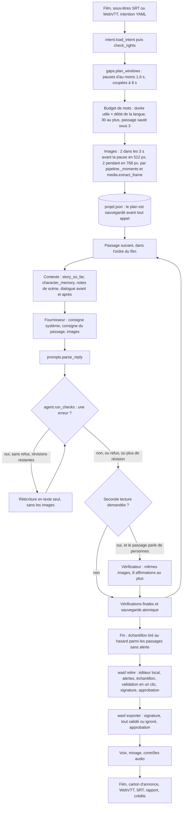

# Audit de l'agent Wasf : architecture et synthèse

Audit en lecture seule, fait le 15 novembre 2026 sur la branche `main` (commit `34c491a`).
Aucun fichier de l'application n'a été modifié et aucune dépendance n'a été ajoutée au projet.
Le même jour, après l'audit, l'équipe a fait corriger quatre constats : voir
[Corrections faites après l'audit](#corrections-faites-après-laudit). Le reste du document décrit
le code audité, sauf là où il est écrit « corrigé ».

## Comment l'audit a été fait

- **Lecture du code** : tout le dossier `wasf/`, soit environ 4 900 lignes de Python, plus
  l'éditeur de relecture (365 lignes de Python, 380 de JavaScript).
- **Exécution sans aucun service d'IA** : la chaîne complète a tourné avec le fournisseur `mock`,
  et de petites réponses de modèle écrites à la main ont servi à vérifier ce que l'agent fait d'une
  réponse donnée. Ces essais vérifient le comportement de Wasf. Ils ne disent rien de ce qu'un
  vrai modèle voit.
- **Mesures** de temps, de mémoire et de taille sur un film synthétique de 10 minutes fabriqué par
  FFmpeg. Le détail est dans [PERFORMANCE_RELIABILITY_AUDIT.md](PERFORMANCE_RELIABILITY_AUDIT.md).
- **Aucun appel à Gemini, Claude, OpenAI ou Ollama.** L'audit ne contient donc aucun résultat
  sur la justesse des descriptions, et n'en invente aucun.

## Les rapports

| Rapport | Sujet |
| --- | --- |
| Ce document | Synthèse, ce qui est implémenté, schéma du flux, composants |
| [AI_CAPABILITIES_AUDIT.md](AI_CAPABILITIES_AUDIT.md) | Vision, choix des images, qualité des descriptions |
| [MULTILINGUAL_AUDIT.md](MULTILINGUAL_AUDIT.md) | Français, arabe standard et derja, chacun à part |
| [VALIDATION_AUDIT.md](VALIDATION_AUDIT.md) | Chaque contrôle automatique, révisions, seconde lecture, échantillon |
| [PROVIDER_COMPARISON_AUDIT.md](PROVIDER_COMPARISON_AUDIT.md) | Gemini, Claude, OpenAI, Ollama : ce que fait le code, ce qui n'est pas mesuré |
| [AUTONOMY_AUDIT.md](AUTONOMY_AUDIT.md) | Qui décide quoi : modèle, règles, consignes, chaîne, humains |
| [ETHICS_PRIVACY_AUDIT.md](ETHICS_PRIVACY_AUDIT.md) | Consentement, données, validation humaine, transparence |
| [PERFORMANCE_RELIABILITY_AUDIT.md](PERFORMANCE_RELIABILITY_AUDIT.md) | Mesures, pannes, reprise, gros films |
| [BENCHMARK_PROTOCOL.md](BENCHMARK_PROTOCOL.md) | Jeu de scènes et métriques pour mesurer ce qui ne l'est pas encore |

## Synthèse

**Ce qu'est Wasf aujourd'hui.** Une chaîne fixe. Pour chaque pause du dialogue, elle envoie
quatre images fixes à un modèle de vision, une seule fois, puis contrôle la réponse avec des
règles écrites à la main. Quand une règle bloque, elle fait réécrire le texte, sans les images.
Elle remet ensuite tout à un humain, et rien n'est exporté sans lui. Le modèle ne choisit pas les
images qu'il reçoit et ne décide pas quand recommencer. Il ne peut pas non plus demander à revoir
la scène. Wasf est donc un agent au sens faible : une orchestration de consignes et d'appels,
encadrée par des règles et par la relecture humaine. C'est un choix du projet, résumé par
« l'IA écrit, la réalisation décide ».

**Ce qui tient, vérifié dans le code et à l'exécution :**
- Le contrôle humain est imposé à l'export. Il faut une signature, chaque passage doit être
  validé ou ignoré, et la réalisation doit approuver, sauf option explicite que les crédits
  annoncent.
- Tout reste traçable : le texte de l'IA est gardé à part, avec le journal de l'agent, l'historique
  et le rapport de transparence.
- La reprise est sûre : le projet est sauvegardé de façon atomique après chaque passage, et une
  erreur qui reviendrait à chaque passage arrête la préparation.
- L'éditeur n'écoute que sur l'ordinateur local.
- Une simulation est toujours annoncée comme telle.

**Ce qui manque ou ne tient pas encore :**
- Personne n'a mesuré la justesse visuelle ni l'utilité pour des spectateurs aveugles ou
  malvoyants.
- Les contrôles automatiques jugent la forme du texte et sa cohérence avec ce que le modèle dit
  avoir vu. Ils ne jugent pas ce qui est à l'écran.
- Plusieurs phrases des crédits et de la documentation promettaient plus que ce que le code
  garantissait : consentement, mention dans le SRT, entraînement, certitude. Ces quatre points
  sont corrigés. Il en reste d'autres, comme la note de confiance affichée en pourcentage ou les
  tests avec des spectateurs aveugles annoncés dans la documentation.
- L'agent ne voit que quelques images fixes par pause, et n'entend jamais le son du film.

### Constats principaux

Gravité : **élevée** quand le constat touche la confiance qu'on peut accorder à la piste ou une
promesse éthique, **moyenne** quand il touche un usage réel courant, **faible** sinon. « Exécuté »
veut dire que le comportement a été reproduit avec le code audité ; « lu » veut dire qu'il vient
de la lecture du code. La colonne « État » dit ce qui a été corrigé depuis.

| # | Constat | Gravité | Comment | État | Rapport |
| --- | --- | --- | --- | --- | --- |
| 1 | `accord_producteur: non` (et tout texte non vide, comme `"false"` entre guillemets) passe le contrôle du consentement. La référence de l'accord n'est pas exigée, alors que `ETHIQUE_360.md` dit le contraire | Élevée | Exécuté | **Corrigé** | [Éthique](ETHICS_PRIVACY_AUDIT.md) |
| 2 | Après une réécriture en texte seul, la note de confiance que le modèle se donne remplace celle qu'il avait donnée en voyant les images. Un passage noté 0,3 peut perdre son alerte et devenir validable en un clic | Élevée | Exécuté | **Corrigé** | [Validation](VALIDATION_AUDIT.md) |
| 3 | Un geste inventé et aussi inscrit dans les observations du modèle ne déclenche aucune alerte : les contrôles vérifient la cohérence du modèle avec lui-même (limite déjà écrite dans le README) | Élevée | Exécuté | Ouvert | [Validation](VALIDATION_AUDIT.md) |
| 4 | Ce qui se passe pendant un dialogue, plus de 3 s avant une pause, n'est jamais montré au modèle. Le modèle n'entend jamais la bande son | Élevée (choix de conception) | Lu | Ouvert | [Capacités](AI_CAPABILITIES_AUDIT.md) |
| 5 | Aucune mesure de justesse, aucune comparaison des fournisseurs, et ni les jetons ni le temps de réponse ne sont enregistrés | Élevée pour toute affirmation de qualité | Lu | Ouvert | [Fournisseurs](PROVIDER_COMPARISON_AUDIT.md) |
| 6 | La seconde lecture : un verdict « incertain » ne lève aucune alerte, 8 affirmations au plus sont vérifiées, et le vérificateur reçoit les affirmations à confirmer | Moyenne | Exécuté | Ouvert | [Validation](VALIDATION_AUDIT.md) |
| 7 | Le SRT exporté ne contient aucune mention de l'IA. Dans le WebVTT, la mention est une note que les lecteurs n'affichent pas. Avec `--sans-annonce`, le MP4 n'en porte aucune. La documentation dit l'inverse pour le SRT | Moyenne | Exécuté | **Corrigé pour le SRT** ; ouvert pour le WebVTT et le MP4 | [Éthique](ETHICS_PRIVACY_AUDIT.md) |
| 8 | Les crédits affirment sans condition que le film n'entraîne aucun modèle, et que les émotions ne sont « jamais » nommées avec certitude | Moyenne | Exécuté | **Corrigé** | [Éthique](ETHICS_PRIVACY_AUDIT.md) |
| 9 | L'échantillon tiré au hasard (10 %, au moins 3) est un garde-fou, pas une garantie : avec 3 passages relus et 10 % de passages faux, on a 73 % de chances de n'en voir aucun. Une erreur trouvée ne déclenche rien | Moyenne | Calculé | Ouvert | [Validation](VALIDATION_AUDIT.md) |
| 10 | Les descriptions déjà écrites par l'IA, pas encore relues, servent de contexte aux passages suivants : une erreur peut se propager | Moyenne | Lu | Ouvert | [Capacités](AI_CAPABILITIES_AUDIT.md) |
| 11 | Les dialogues, les notes de la réalisation et la liste de ce qu'il ne faut jamais révéler partent chez le fournisseur en ligne avec les images | Moyenne | Lu | Ouvert | [Éthique](ETHICS_PRIVACY_AUDIT.md) |
| 12 | Avec Ollama sur une autre machine, ou avec `--url`, aucun rappel sur les données n'est affiché, et le rapport ne dit pas où les images sont parties | Moyenne | Lu | Ouvert | [Éthique](ETHICS_PRIVACY_AUDIT.md) |
| 13 | La mesure d'énergie de la préparation ne couvre pas l'extraction des images, qui a pris 97 % du temps de préparation dans l'essai fait avec la simulation | Moyenne | Exécuté | Ouvert | [Performance](PERFORMANCE_RELIABILITY_AUDIT.md) |
| 14 | Le carton d'annonce réencode tout le film : 239 s d'export au lieu de 64 s pour 10 minutes en 1080p | Moyenne | Mesuré | Ouvert | [Performance](PERFORMANCE_RELIABILITY_AUDIT.md) |
| 15 | L'adaptateur Claude plafonne la réponse à 400 jetons et ne vérifie pas si elle a été coupée ; une réponse JSON complète en arabe peut l'atteindre (non mesuré) | Moyenne | Lu | Ouvert | [Fournisseurs](PROVIDER_COMPARISON_AUDIT.md) |
| 16 | La derja repose sur des consignes et des listes de mots, dont une partie n'a pas été relue par un·e locuteur·rice natif·ve. Une piste en arabe standard qui glisse vers le dialecte n'est pas signalée | Moyenne | Lu | Ouvert | [Multilingue](MULTILINGUAL_AUDIT.md) |
| 17 | Des documents annoncent des tests avec des spectateurs aveugles et un pilote avec IBSAR, dont le dépôt ne montre aucune trace | Moyenne | Lu | Ouvert | [Éthique](ETHICS_PRIVACY_AUDIT.md) |
| 18 | L'éditeur affiche encore « confiance 30 % » au-dessus du texte de l'IA, alors que le README dit qu'elle est montrée comme une note et non comme une probabilité | Faible | Lu | Ouvert | [Validation](VALIDATION_AUDIT.md) |
| 19 | Rien n'empêche deux préparations de tourner en même temps sur le même dossier | Faible | Lu | Ouvert | [Performance](PERFORMANCE_RELIABILITY_AUDIT.md) |
| 20 | Une erreur fatale pendant une réécriture laisse le passage marqué « fait », avec ses erreurs : `--refaire-echecs` ne le reprend pas | Faible | Exécuté | Ouvert | [Performance](PERFORMANCE_RELIABILITY_AUDIT.md) |
| 21 | La note d'une scène (« à faire remarquer ») est donnée à chaque passage de la scène, ce qui pousse à la répéter même quand elle n'est plus visible | Faible | Lu | Ouvert | [Capacités](AI_CAPABILITIES_AUDIT.md) |
| 22 | L'option `--sans-validation-realisateur` n'a ni aide dans la ligne de commande ni ligne dans le README | Faible | Lu | Ouvert | [Éthique](ETHICS_PRIVACY_AUDIT.md) |
| 23 | Les WebVTT et SRT suivent les instants du film d'origine. Avec le carton, qui est mis par défaut, le film de `film_audiodecrit.mp4` commence 6,9 s plus tard dans l'essai : chargés avec ce fichier, les sous-titres arrivent en avance d'autant | Moyenne | Mesuré | Ouvert, trouvé pendant les corrections | [Performance](PERFORMANCE_RELIABILITY_AUDIT.md) |

## Corrections faites après l'audit

Le même jour, l'équipe a demandé de corriger quatre constats. Rien d'autre n'a changé dans le code.

| # | Ce qui change | Fichiers | Tests ajoutés |
| --- | --- | --- | --- |
| 1 | `accord_producteur` n'accepte plus que `true`, écrit sans guillemets. Tout autre mot, même « oui » ou « non », arrête la préparation et dit quoi écrire. La référence de l'accord est obligatoire | `wasf/intent.py` | `tests/test_consent.py` (18) |
| 2 | Une réécriture en texte seul peut baisser la note de confiance du brouillon, jamais la remonter. Une note inconnue au brouillon reste inconnue, donc signalée. Le journal garde la note que la réécriture s'est donnée | `wasf/agent.py` (`confidence_after_rewrite`) | `tests/test_confidence_rewrite.py` (12) |
| 7 | Le SRT s'ouvre sur la mention de l'IA, en premier sous-titre, dès le début du film. Elle reste à l'écran le temps de la dire au débit de la piste, 4 s au moins. Une description qui commence pendant ces secondes s'affiche avec elle | `wasf/export.py` (`write_srt`, `notice_seconds`), `wasf/pipeline.py` | `tests/test_export_mentions.py` (5, avec le point 8) |
| 8 | Les crédits disent « Wasf n'entraîne aucun modèle d'IA sur ce film. » Pour Gemini, Claude et OpenAI, ils ajoutent que les images et les textes envoyés relèvent des conditions du fournisseur, que Wasf ne peut pas vérifier. La ligne des émotions dit ce que l'IA avait pour consigne, ce qu'un mot de certitude bloque et ce qui est seulement signalé | `wasf/export.py` (`_training_lines`, `_emotions_line`) | `tests/test_export_mentions.py` |

**Résultats** :
- 331 tests réussis sous Linux, dont les 35 nouveaux, avec CodeCarbon 3.3.2 actif et sans aucun
  avertissement.
- Aucun test existant n'a été modifié.
- Le linter (ruff) donne les mêmes 25 constats qu'avant, aucun nouveau.

**Ce qui reste ouvert** :
- La mention de l'IA reste invisible dans le WebVTT, et absente du MP4 exporté avec
  `--sans-annonce`.
- Le rapport écrit encore `entrainement_sur_le_film: false`.
- L'éditeur affiche toujours la confiance en pourcentage.
- Tous les autres constats du tableau marqués « Ouvert ». Le constat 23 a été trouvé pendant ces
  corrections.

## 1. Ce qui est implémenté, et ce qui ne l'est pas

| Fonction | État dans le code |
| --- | --- |
| Audiodescription en français, arabe standard et derja : pauses, images, brouillon, contrôles, relecture, voix, export | Implémentée |
| Choix des images là où l'image change (`--choix-images auto`) | Implémenté, par défaut |
| Seconde lecture des affirmations visuelles, par le même modèle ou un autre | Implémentée, désactivée par défaut, gain jamais mesuré |
| Sous-titres dynamiques pour spectateurs sourds et malentendants (SME) | Pas codés : maquettes seulement (le README le dit) |
| Amazigh | Absent du code, seulement sur la feuille de route |
| Mesure de la justesse sur de vraies scènes | Pas faite. Un protocole existe (`docs/TESTS_EMOTIONS.md`) |
| Évaluation par des spectateurs aveugles ou malvoyants | Pas faite |
| Comparaison des fournisseurs | Pas faite |
| Enregistrement des jetons consommés et du temps de réponse | Absent |
| Apprentissage à partir des corrections de la réalisation | Absent. Aucun entraînement non plus, par choix |
| Suivi des visages, reconnaissance faciale, classifieur d'émotions | Absents, par choix |

## 2. Le flux réel, du film à la description approuvée

En mots, pour un film :

1. `wasf preparer` lit l'intention et refuse le film sans accord du producteur
   (`Intent.check_rights`).
2. Les pauses viennent des sous-titres (écart d'au moins 1,6 s entre deux répliques) ou, sans
   sous-titres, des silences trouvés par FFmpeg. Les pauses longues sont coupées en passages de
   8 s au plus (`gaps.split_long`).
3. Chaque passage reçoit un budget de mots : sa durée utile, moins 0,3 s de marge de chaque côté,
   multipliée par le débit de la langue (2,5 mots par seconde en français, 2,0 en arabe, 2,2 en
   derja), avec un plafond de 30. Sous 3 mots, le passage est abandonné.
4. Quatre images sont extraites par défaut, et le projet est sauvegardé avant le premier appel au
   modèle.
5. Les passages sont écrits un par un, dans l'ordre du film. Chacun reçoit ce qui précède : les
   dialogues et les descriptions déjà écrites (1 500 caractères au plus), le dernier état connu de
   chaque personnage nommé, et les notes de la réalisation pour sa scène.
6. Le modèle rend un objet JSON : observations, changements, interactions, émotions supposées,
   description, appuis de chaque phrase, confiance. Des règles le contrôlent. Une erreur entraîne
   au plus 2 réécritures en texte seul. Un refus n'est jamais réécrit.
7. Le projet est sauvegardé après chaque passage. À la fin, un échantillon est tiré au hasard
   parmi les passages sans alerte.
8. Dans l'éditeur, la réalisation corrige, valide, signe et approuve. L'export refuse tout le reste,
   sauf en version de travail (`--brouillon`), annoncée comme telle.

## 3. Les composants

Chaque composant est décrit par son fichier, ses fonctions principales, ce qui entre et sort, ce
dont il dépend, son rôle et ses limites connues.

### 3.1 Points d'entrée

- **Fichiers** : `wasf/cli.py` (`main`, `_parser`), `wasf/__main__.py`, `wasf/demo.py` (`make_demo`).
- **Entrée** : la ligne de commande : `demo`, `preparer`, `relire`, `exporter` et leurs options.
- **Sortie** : l'appel à `prepare`, `render` ou à l'éditeur ; un code de sortie (0, 1, ou 130
  après Ctrl+C) et un message d'erreur en français d'une ligne.
- **Dépend de** : `argparse`, `pipeline`, `editor.app`, `demo`.
- **Rôle** : lire les options et transformer les erreurs connues (`KNOWN_ERRORS`) en messages
  lisibles.
- **Limites** : `--sans-validation-realisateur` n'a pas de texte d'aide. Il n'y a pas de fichier
  de réglages : chaque option se retape à chaque commande.

### 3.2 Orchestration

- **Fichier** : `wasf/pipeline.py`.
- **Fonctions** : `prepare`, `_draft`, `_go_on` (reprise), `_restore_frames`,
  `_protect_existing`, `_stop_on_fatal`, `render`, `readiness_problems`, `check_recordings`,
  `_film_check`, `changed_during_export`.
- **Entrée** : la vidéo, l'intention, les sous-titres et les options.
- **Sortie** : un dossier de projet (`projet.json` et `images/`), puis un dossier d'export.
- **Dépend de** : tous les autres modules.
- **Rôle** : enchaîner les étapes, sauvegarder après chaque passage, arrêter sur une erreur
  fatale, refuser un export incomplet.
- **Limites** : tout est séquentiel, un passage à la fois. Aucun verrou n'empêche deux
  préparations sur le même dossier. La mesure d'énergie de la préparation n'entoure que l'écriture
  des passages, pas l'extraction des images.

### 3.3 Adaptateurs des fournisseurs d'IA

- **Fichier** : `wasf/providers.py`.
- **Classes et fonctions** : `Provider`, `MockProvider`, `GeminiProvider`, `AnthropicProvider`,
  `OpenAIProvider`, `OllamaProvider`, `get_provider`, `ProviderError`, `is_fatal`, `_retry_wait`.
- **Entrée** : la consigne système, la consigne du passage, les images JPEG en octets, et des
  métadonnées (mode, langue, budget).
- **Sortie** : le texte brut de la réponse, et les noms de modèles que l'API dit avoir utilisés
  (`models_seen`).
- **Dépend de** : `google-genai`, `anthropic`, `openai` (facultatifs), `requests` pour Ollama.
- **Rôle** : une même méthode `generate` pour cinq fournisseurs, avec des erreurs classées
  passagères ou fatales.
- **Limites** : rien n'enregistre les jetons ni le temps de réponse. Seuls Gemini et Ollama
  demandent une réponse au format JSON. Claude est plafonné à 400 jetons de réponse. Les nouvelles
  tentatives diffèrent d'un fournisseur à l'autre (détails dans
  [PROVIDER_COMPARISON_AUDIT.md](PROVIDER_COMPARISON_AUDIT.md)).

### 3.4 Consignes

- **Fichier** : `wasf/prompts.py`.
- **Contenu** : `SYSTEM_PROMPT` (11 règles, 2 449 caractères), `LANG_SPECS` (une consigne par
  langue), `EMOTION_RULES`, `build_draft_prompt`, `build_revision_prompt`, `SECOND_LOOK_PROMPT`,
  `build_second_look_prompt`.
- **Lecture des réponses** : `parse_reply`, `parse_confidence`, `parse_second_look`,
  `structure_problems`.
- **Entrée** : le passage, le contexte et les choix de la réalisation.
- **Sortie** : le texte des consignes, puis la réponse du modèle mise en champs.
- **Rôle** : dire au modèle quoi décrire et comment, et lire sa réponse même mal formée.
- **Limites** : la consigne système est en français pour les trois langues. Une réponse qui n'est
  pas du JSON devient telle quelle la description, puis passe les contrôles. Le projet ne garde
  pas la version des consignes : seul le numéro de version de Wasf est noté.

### 3.5 Choix et extraction des images

- **Fichiers** : `wasf/media.py` (`extract_frame`, `thumbnails`, `most_distinct`, `change_score`)
  et `wasf/pipeline.py` (`_moments`).
- **Constantes** : `CONTEXT_FRAME_WIDTH = 512`, `CANDIDATES = 6`, `THUMB_SIZE = (64, 36)`,
  `STILL = 6.0`, `TOP_SHARE = 0.10`.
- **Entrée** : la vidéo, une fenêtre de temps et un nombre d'images.
- **Sortie** : des JPEG de 768 px de large pendant la pause et de 512 px avant (qualité `-q:v 4`),
  avec l'instant de chacun.
- **Dépend de** : FFmpeg et numpy.
- **Rôle** : garder, parmi 6 vignettes grises de 64 × 36 pixels, les moments où l'image change le
  plus. Un panoramique est compensé et un fondu neutralisé.
- **Limites** : seulement 6 candidats par groupe. Seuls les décalages sont compensés, pas le zoom.
  Pas de détection des changements de plan. Rien n'est vu en dehors de la fenêtre qui va de 3 s
  avant la pause jusqu'à sa fin.

### 3.6 Construction du contexte

- **Fichiers et fonctions** :
  - `wasf/story.py` (`story_so_far`, 1 500 caractères au plus) ;
  - `wasf/continuity.py` (`character_memory`, 6 lignes et 3 faits par personnage au plus) ;
  - `gaps.neighbours` ;
  - `Intent.notes_for` ;
  - `textnorm.dialogue_language`.
- **Entrée** : les répliques des sous-titres, les passages déjà écrits, les personnages et les
  scènes de l'intention.
- **Sortie** : des lignes de texte ajoutées à la consigne du passage.
- **Rôle** : donner au modèle le passé de l'histoire, jamais la suite.
- **Limites** :
  - Les descriptions passées sont celles de l'IA, pas encore relues.
  - La continuité repose sur les noms : un personnage mal nommé l'est aussi dans la mémoire.
  - La note d'une scène est répétée à chacun de ses passages.

### 3.7 Écriture des descriptions

- **Fichier** : `wasf/agent.py`, classe `DescriberAgent`, méthode `describe`.
- **Entrée** : le passage, ses images, le contexte et la description précédente.
- **Sortie** : le passage rempli : `brouillon_ia`, `texte`, `confiance_ia`, `observations_ia`,
  `emotions_ia`, `changements_ia`, `interactions_ia`, `appuis_ia`, `seconde_lecture`,
  `verifications`, `journal_agent`.
- **Rôle** : un appel avec images, les contrôles, les réécritures, la seconde lecture si elle est
  demandée, puis le passage au statut `brouillon`.
- **Limites** : un seul appel avec images par passage, en dehors de la seconde lecture. Aucune
  nouvelle tentative avec d'autres images ou plus d'images.

### 3.8 Contrôles

- **Fichiers et fonctions** :
  - `agent.run_checks`, `agent.review_flags`, `agent.voice_checks` ;
  - `wasf/textnorm.py` (refus, écriture, arabe standard, répétition, liste « à éviter ») ;
  - `wasf/emotions.py` (`check_emotions`, `check_evidence`) ;
  - `mix.timing_problems` et `mix.quality_problems` pour les voix.
- **Entrée** : un texte, son budget, la liste « à éviter », le dialogue voisin, et la réponse
  structurée du modèle.
- **Sortie** : une liste de résultats `erreur` (bloque), `attention` (signale) ou `ok`.
- **Rôle** : bloquer ce qui ne doit jamais sortir, signaler ce qu'un humain doit regarder.
- **Limites** : ce sont des règles sur les mots, et une cohérence du modèle avec lui-même. Le
  détail est dans [VALIDATION_AUDIT.md](VALIDATION_AUDIT.md).

### 3.9 Réécriture

- **Où** : la boucle de `DescriberAgent.describe` et `prompts.build_revision_prompt`.
- **Réglage** : `--revisions`, 2 par défaut.
- **Entrée** : le brouillon, les erreurs trouvées, les observations du modèle et le budget.
- **Sortie** : un nouveau texte, une nouvelle confiance et de nouveaux appuis.
- **Rôle** : corriger ce qu'une règle bloque, sans renvoyer les images (moins cher, moins
  d'énergie).
- **Limites** : la réécriture ne voit pas l'image. Elle ne part que sur une erreur, jamais sur une
  alerte. **Corrigé** : la confiance qu'elle rend peut baisser celle du brouillon, jamais la
  remonter (`confidence_after_rewrite`). Avant la correction, elle la remplaçait.

### 3.10 Seconde lecture

- **Où** : `DescriberAgent._second_look`, `pipeline._second_reader`, `SECOND_LOOK_PROMPT`.
- **Options** : `--seconde-lecture [meme|gemini|anthropic|openai|ollama]` et
  `--modele-seconde-lecture`.
- **Entrée** : les mêmes images et au plus 8 affirmations du modèle (observations, changements,
  interactions).
- **Sortie** : un verdict « oui », « non » ou « incertain » par affirmation.
- **Rôle** : signaler une phrase qui repose sur une affirmation que le vérificateur n'a pas vue.
- **Limites** :
  - Elle ne vérifie que les passages qui parlent de personnes.
  - « Incertain » ne lève aucune alerte.
  - Une erreur du vérificateur est notée dans le journal puis oubliée.

### 3.11 Erreurs

- **Où** :
  - `ProviderError` (avec `fatal`), `is_fatal`, `_retry_wait`, `_gemini_error` ;
  - `pipeline._stop_on_fatal` ;
  - les exceptions propres à chaque module (`MediaError`, `RenderError`, `TTSError`,
    `ResumeError`, `ProjectFileError`, `SubtitleError`, `IntentError`, `RightsError`).
- **Rôle** : une erreur passagère vide un seul passage, qui est signalé. Une erreur qui
  reviendrait à chaque passage arrête tout, en gardant ce qui est fait.
- **Limites** : pendant une réécriture ou une seconde lecture, toute erreur est avalée, même
  fatale. Le passage garde alors son état « fait ».

### 3.12 Persistance et reprise

- **Fichiers** : `wasf/project.py` (`Project`, `Segment`, `save_project`, `load_project`,
  `ProjectFileError`) et `pipeline._go_on`, `_restore_frames`, `_protect_existing`.
- **Entrée et sortie** : `projet.json`, en UTF-8.
- **Rôle** :
  - L'écriture est atomique : fichier temporaire, `fsync`, puis `os.replace`.
  - Le projet est sauvegardé après chaque passage.
  - `--reprendre` et `--refaire-echecs` continuent sans redemander à l'IA ce qui est fait.
  - Un ancien projet n'est jamais écrasé : il part dans un dossier `sauvegarde-…`.
- **Limites** : le fichier entier est réécrit à chaque passage (20 à 30 ms mesurés jusqu'à
  600 passages). Aucun verrou entre deux processus.

### 3.13 Éditeur de relecture

- **Fichiers** : `wasf/editor/app.py` (`create_app`, `guard`, `harden`, `recheck`,
  `update_segment`, `validate_without_alerts`, `ensure_sample`), `editor/static/editor.js`,
  `editor/templates/index.html`.
- **Entrée** : `projet.json` et les actions de la personne qui relit.
- **Sortie** : le projet mis à jour : textes, statuts, signatures, approbation.
- **Rôle** : montrer les images, le texte de l'IA, ce qu'elle dit avoir vu et les alertes. Imposer
  la relecture de l'échantillon avant la validation en un clic. Retirer l'approbation à chaque
  changement.
- **Limites** :
  - Il montre les images fixes, jamais la vidéo.
  - La signature est un nom tapé, sans compte ni authentification.
  - La confiance de l'IA est affichée en pourcentage au-dessus de son texte.

### 3.14 Voix, mixage et exports

- **Fichiers** : `wasf/tts.py`, `wasf/mix.py` (`build_mix`), `wasf/export.py` (`label_text`,
  `transparency_report`, `write_vtt`, `write_srt`, `write_credits`, `make_card`), et
  `media.mux`, `media.prepend_card`.
- **Entrée** : les passages validés et le moteur de voix.
- **Sortie** : le film audiodécrit (piste par défaut, version originale en seconde piste), les
  WAV, le WebVTT, le SRT, `rapport_transparence.json` et `credits.txt`.
- **Rôle** : vocaliser, accélérer une voix de 1,3 fois au plus, refuser une voix qui déborde de sa
  pause, annoncer l'IA en tête du film.
- **Limites** :
  - Dans le WebVTT, la mention de l'IA est une note que les lecteurs n'affichent pas. Le SRT,
    qui n'en avait aucune, l'affiche en premier sous-titre depuis la correction.
  - Le carton d'annonce réencode tout le film.
  - Les sous-titres suivent les instants du film d'origine, pas ceux de `film_audiodecrit.mp4`
    quand le carton le précède.
  - Les deux phrases des crédits écrites sans condition (entraînement, certitude des émotions)
    sont corrigées.

### 3.15 Mesure d'énergie

- **Fichier** : `wasf/energy.py` (`EnergyMeter`, `tracker_options`).
- **Rôle** : mesurer avec CodeCarbon quand il est installé, sinon chronométrer seulement.
- **Limites** : la mesure « préparation » ne couvre pas l'extraction des images. Les serveurs
  d'un fournisseur en ligne ne sont jamais mesurés, et le rapport le dit.

## 4. Les états d'un passage et du projet

| Champ | Valeurs | Qui le change |
| --- | --- | --- |
| `Segment.etat_ia` | `a_faire`, `fait`, `echec` | La préparation : avant l'appel, puis après |
| `Segment.statut` | `brouillon`, `modifie`, `valide`, `ignore` | L'agent met `brouillon`, l'éditeur le reste |
| `Segment.valide_en_lot` | vrai ou faux | La validation en un clic |
| `Project.preparation["etat"]` | `en_cours`, `terminee` | La préparation. Pendant `en_cours`, l'éditeur et l'export refusent toute modification |
| `Project.validation_realisateur` | vrai ou faux | L'éditeur. Retirée à chaque texte modifié, passage rouvert ou nom changé |

Le texte de l'IA (`brouillon_ia`) n'est jamais modifié après la préparation : c'est ce qui permet
au rapport de mesurer la part changée par un humain.
