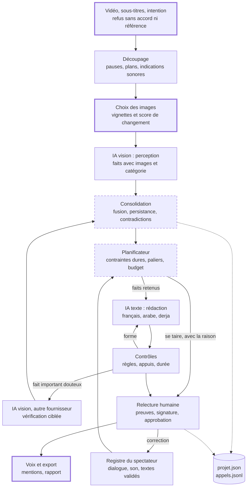
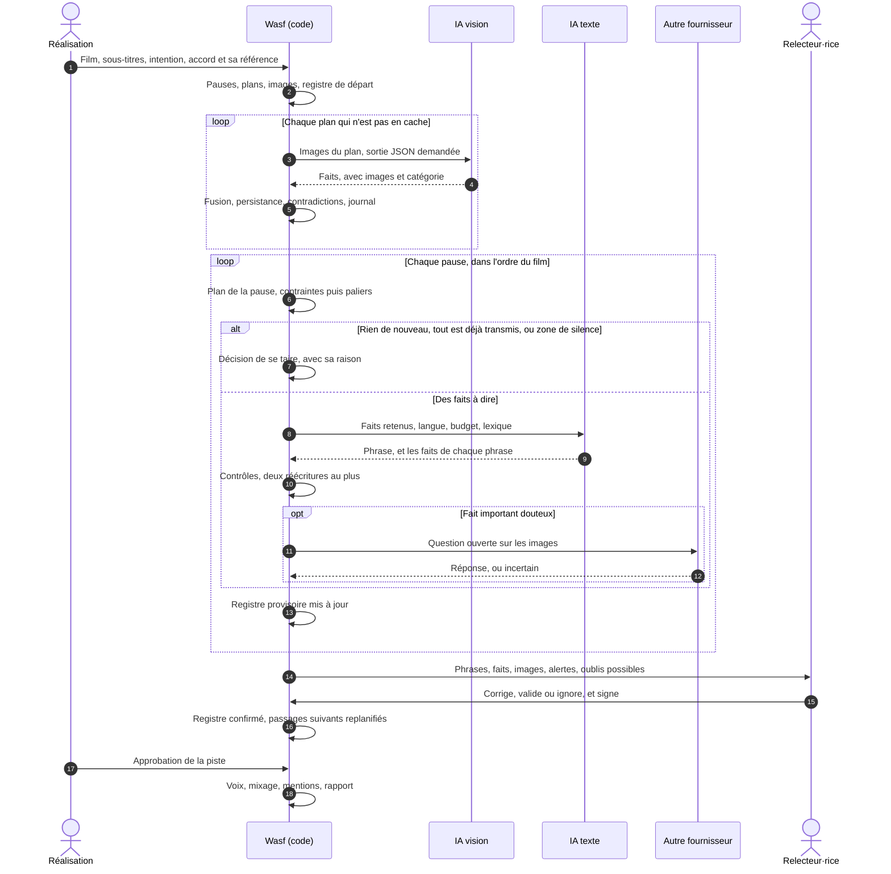

# Wasf : spécification de mise en œuvre du nouvel agent

Document de conception de l'équipe Bou Dinar, 15 novembre 2026. Il part du diagnostic stratégique
et des neuf rapports d'audit (`docs/*_AUDIT.md`), et chaque affirmation sur l'état actuel a été
vérifiée dans le code. **Ce document ne change pas le code.** Chaque phase ne commencera qu'avec
l'accord de l'équipe.

| Marque | Sens |
| --- | --- |
| [Existe] | Dans le code aujourd'hui ; le fichier est cité |
| [À modifier] | Existe, mais doit changer |
| [Proposé] | À construire |
| [Recherche] | Idée à tester, sans résultat connu |
| [Écarté] | Jugé inutile, avec la raison |

**Ce qui n'a jamais été mesuré.** Wasf n'a encore tourné sur aucun vrai modèle : la qualité de ses
descriptions est inconnue. Les seuls chiffres de ce document sont les mesures de performance de
l'audit, faites sur un film synthétique de 10 minutes avec la simulation
(`docs/PERFORMANCE_RELIABILITY_AUDIT.md`). Aucune personne aveugle ou malvoyante n'a évalué Wasf.

**Où en est-on.** La phase 0 est faite pour sa partie code, le 15 novembre 2026 : garde de
version, journal des appels, limite de réponse de Claude réglable (détails dans
[`BASELINE.md`](BASELINE.md)). L'essai réel attend un modèle. L'équipe a décidé de ne rien
filmer : le banc d'essai repose sur des clips synthétiques et, si elle le décide, sur des extraits
de films sous licence libre (section 9.3).

## Sommaire

1. [Résumé et feuille de route](#1-résumé-et-feuille-de-route)
2. [L'architecture actuelle, vérifiée](#2-larchitecture-actuelle-vérifiée)
3. [L'architecture cible](#3-larchitecture-cible)
4. [Le modèle de données](#4-le-modèle-de-données)
5. [Le déroulé, étape par étape](#5-le-déroulé-étape-par-étape)
6. [Choisir quoi dire](#6-choisir-quoi-dire)
7. [La mémoire](#7-la-mémoire)
8. [Image, dialogue, son : qui établit quoi](#8-image-dialogue-son--qui-établit-quoi)
9. [Modèles, coûts et mesures](#9-modèles-coûts-et-mesures)
10. [Les phases](#10-les-phases)
11. [Tests et critères d'acceptation](#11-tests-et-critères-dacceptation)
12. [Recherche](#12-recherche)
13. [Risques](#13-risques)
14. [Recommandation](#14-recommandation)

## 1. Résumé et feuille de route

**Aujourd'hui** [Existe], pour chaque pause du dialogue, Wasf envoie à un modèle de vision quatre
images (deux prises dans les 3 secondes avant la pause, deux pendant), ce qui s'est passé avant
sous forme de texte, et les consignes de la réalisation. Le modèle répond en JSON : ce qu'il a vu,
une phrase, et pour chaque phrase les observations qui la fondent. Le code vérifie la phrase et
peut la faire réécrire deux fois, sans les images. Une personne relit et signe, la réalisation
approuve, et l'export refuse tout le reste.

**Le changement proposé** tient en une phrase : décrire des faits prouvés, choisis par le code, au
lieu de légender des pauses.

Cinq principes, les mêmes à toutes les phases :

1. **Traçable.** Chaque phrase de l'IA renvoie à des faits ; chaque fait, à ses images et à leurs
   instants dans le film.
2. **Choisi par le code.** Le code décide quoi dire, sous les règles de la réalisation. Il peut
   décider de se taire, et il note pourquoi.
3. **Le dialogue n'invente rien.** Le dialogue et le son disent ce que le spectateur sait déjà. Ils
   ne créent jamais un fait visuel.
4. **L'humain décide.** Une personne signe chaque passage, la réalisation approuve la piste. Aucune
   phase ne retire une de ces gardes.
5. **Mesurer avant d'affirmer.** Chaque phase est comparée à la précédente sur les mêmes scènes
   figées.

Exclus à toutes les phases [Écarté] : entraîner un modèle sur les films, reconnaître les visages ou
les émotions, une base de données ou un graphe de connaissances, plusieurs agents qui débattent.
Tout tient dans `projet.json`, plus un journal des appels.

**La feuille de route en un tableau**

| Phase | Objectif | Résultat attendu | Complexité | Dépend de | Critère d'acceptation principal |
| --- | --- | --- | --- | --- | --- |
| 0. Base et mesure | Savoir ce que Wasf produit avec un vrai modèle | Journal des appels et garde de version (faits) ; un premier essai réel (en attente d'un modèle) | Faible | Un modèle disponible : Ollama, sans clé, ou une clé d'API | Chaque appel a sa ligne au journal ; la suite de tests passe |
| 1. Faits prouvés | Relier chaque phrase à des faits, chaque fait à ses images | La chaîne phrase, faits, images, visible dans l'éditeur | Moyenne | 0 | Aucun fait de l'IA sans image, aucune phrase sans fait, sauf signalés |
| 2. Contexte temporel | Voir ce qui se passe entre deux pauses | Images aux changements depuis la pause précédente ; plans | Moyenne | 1 | Sur des clips de test, un geste fait pendant un dialogue apparaît dans les faits de la pause suivante |
| 3. Mémoire | Savoir ce que le spectateur sait déjà | Un registre recalculé depuis `projet.json` | Moyenne | 1 | Un fait déjà dit et inchangé n'est jamais redit par l'IA |
| 4. Voir, puis dire | Séparer la perception de la phrase, par langue | Un rédacteur en texte seul pour le français, l'arabe et la derja | Moyenne | 1, 3 | Une phrase de l'IA ne s'appuie que sur des faits fournis |
| 5. Choisir | Le code choisit quoi dire, ou se tait | Un plan par pause, avec les faits omis et leur raison | Moyenne | 3, 4 | Contraintes dures toujours respectées ; chaque silence a sa raison |
| 6. Contrôle par les preuves | Vérifier fait par fait | Vérification ciblée par un autre modèle ; confiance étalonnée | Moyenne | 1, 5 | Un passage avec un fait important douteux n'est jamais validable en un clic |
| 7. Économies et évaluation | Moins d'appels, mieux mesurés | Cache par plan ; comparaison avec la phase 0 | Moyenne | 0 à 6 | Une reprise ne refait aucun appel payé réussi ; chaque gain dépasse la variation entre essais |

L'ordre diffère de la demande sur deux points. **Séparer la perception de la rédaction (phase 4)
passe avant la sélection (phase 5)** : le code ne peut choisir que parmi des faits produits avant la
phrase, alors qu'aujourd'hui voir, choisir et écrire se font dans le même appel. **Une petite part
du contrôle avance en phase 1** : la seconde lecture en question ouverte, et « incertain » qui
devient une alerte. Elle corrige un biais connu pour peu de travail.

## 2. L'architecture actuelle, vérifiée

Vérifiée le 15 novembre 2026 sur la version du dépôt qui contient les quatre corrections de
l'audit : 331 tests, dont 330 passés et 1 sauté, celui qui ne tourne que là où CodeCarbon est
installé (296 tests avant ces corrections). Les chemins sont relatifs au
dossier `wasf/`.

| Composant | Ce qui existe [Existe] | À réutiliser | À changer ou créer | Écarté |
| --- | --- | --- | --- | --- |
| 1. Compréhension du film et des scènes | L'histoire jusque-là, en texte : dialogues passés et descriptions déjà écrites, 1 500 caractères au plus, les plus récents gardés (`story.py`). Les notes de scène de la réalisation : à remarquer, à éviter, contexte (`intent.py`, `notes_for`) | Les notes de scène ; le calcul à partir de `projet.json` | Un état de scène tenu par le code : lieu, personnes présentes, objets en jeu [Proposé, phase 3] | Un « modèle du film » appris |
| 2. Découpage en plans et en scènes | Des pauses seulement : écarts d'au moins 1,6 s entre sous-titres, ou silences FFmpeg à −30 dB ; coupure à 8 s ; marge de 0,3 s ; budget en mots, 30 au plus, passage ignoré sous 3 mots (`gaps.py`, `pipeline.prepare`). Aucune détection de plans | `media.change_score`, qui reconnaît déjà un décalage trop grand comme une coupe et non un panoramique | Les plans : filtre `scdet` de FFmpeg ou vignettes existantes [Proposé, phase 2] ; les scènes : notes de la réalisation d'abord | Un modèle de segmentation appris |
| 3. Choix adaptatif des images | `--choix-images auto` : parmi au moins 6 vignettes grises de 64 × 36, les instants qui diffèrent le plus, panoramiques compensés par corrélation de phase ; plan fixe : instants réguliers. Deux images de contexte à 512 px dans les 3 s avant la pause, deux à 768 px pendant (`media.most_distinct`, `pipeline.prepare`) | Tout | Une fenêtre « depuis la dernière pause » [Proposé, phase 2] ; le seuil de plan fixe (`STILL = 6.0`) à étalonner | Des images en pleine définition |
| 4. Extraction de faits visuels | Réponse JSON : `observations` (4 demandées, 6 gardées au plus), `changements` (qui, avant, après, numéros d'images), `interactions`, `emotions` avec leurs signes et une certitude (`prompts.py`) | Le format JSON et son analyse tolérante (`parse_reply`) | Chaque observation reçoit un identifiant, une catégorie (observé ou déduit), ses images et une forme courte [À modifier, phase 1] | Un détecteur d'objets avant toute mesure |
| 5. Stockage des preuves | Images JPEG dans `images/`, instants dans `projet.json`, réextraites à la reprise si elles manquent (`pipeline._restore_frames`) ; trace de chaque étape de l'agent par passage (`journal_agent`) | Tout | Un identifiant et une empreinte par image [phase 1] ; un journal des appels [Proposé, phase 0] | Une base de données |
| 6. Raisonnement temporel | Images ordonnées avec leur instant, marquées « avant la pause » ou « pendant » ; consigne : décrire ce qui change d'une image à l'autre (`prompts._frames_lines`, règle 4) | Les instants et leur affichage | Fusion, persistance et contradictions des faits, par le code [Proposé, phase 2] | |
| 7. Mémoire narrative | `story_so_far` et `character_memory` (dernier état de chaque personnage nommé, 6 lignes au plus), recalculés depuis `projet.json` à chaque passage, donc justes après une reprise (`story.py`, `continuity.py`) | Le principe : tout recalculer depuis `projet.json` | Des entrées structurées au lieu de lignes de texte [À modifier, phase 3] | Base vectorielle, graphe de connaissances |
| 8. Pertinence de l'information | Le modèle choisit seul (règles 1, 3 et 9 du prompt). Contrôles de texte : `repetition_dialogue` (erreur si 60 % des mots du texte sont dans le dialogue), `repetition`, `geste_repete`, `emotion_dialogue`, `surcharge` (`agent.py`, `emotions.py`) | Ces contrôles, comme filets de sécurité | Contraintes dures puis paliers, dans le code [Proposé, phase 5] | Un score pondéré aux poids inventés |
| 9. Planification de la description | Aucune : voir, choisir et écrire se font dans le même appel | | Un plan par pause [Proposé, phase 5] | |
| 10. Génération multilingue | Français, arabe standard, derja en caractères arabes, par consigne dans le même appel (`prompts.LANG_SPECS`) ; lexique ; exemples ; contrôles `ecriture` et `arabe_standard` | Consignes, lexique, contrôles | Un rédacteur en texte seul par langue [À modifier, phase 4] | Traduire depuis le français (le registre de la derja se perd) |
| 11. Contrôle fondé sur les preuves | Une vingtaine de codes de contrôle (`agent.run_checks`, `emotions.check_evidence`), dont `phrase_sans_appui` ; deux réécritures en texte seul au plus, qui ne remontent jamais la confiance ; seconde lecture optionnelle, faite si on veut par un autre fournisseur, mais en question fermée (oui, non, incertain), où seul « non » déclenche une alerte | Tout | Questions ouvertes, « incertain » en alerte [phase 1] ; contrôles fait par fait, étalonnage [phase 6] | Un « juge » IA qui note la qualité générale |
| 12. Relecture et approbation humaines | Éditeur local (Flask, jeton, hôte vérifié). Valider, ignorer, rouvrir ; une erreur bloque la validation ; un clic seulement pour les textes non modifiés sans alerte, après un échantillon tiré au hasard (10 %, au moins 3 dès 10 passages) validé un par un ; approbation de la réalisation, retirée si un texte ou un nom change. L'export refuse sans signature, sans tous les passages traités, sans approbation, sauf option explicite `--sans-validation-realisateur` (`editor/app.py`, `pipeline.readiness_problems`) | Tout | Montrer la chaîne phrase, faits, images, les faits omis et la raison d'un silence [phases 1 et 5] ; ne plus afficher la note de confiance en pourcentage [phase 6] | |

**Ce que le dépôt ne mesurait pas avant la phase 0** (absences vérifiées) :

- les jetons d'entrée et de sortie : aucun fournisseur ne les enregistre (`providers.py`) ;
- la durée de chaque appel : seules la durée de la rédaction par l'IA, tous passages confondus, et
  celle de l'export sont mesurées (`energy.py`) ;
- le coût en argent : jamais calculé ;
- la raison de fin d'une réponse, complète ou coupée : jamais lue, alors que Claude était limité
  à 400 jetons de sortie (`providers.py`) ;
- les nouvelles tentatives : Wasf ne réessaie lui-même qu'avec Gemini, deux fois, après une
  limite par minute ou des serveurs surchargés ; les SDK d'Anthropic et d'OpenAI réessaient d'eux-mêmes
  par défaut, deux fois, sans que Wasf le voie ;
- l'énergie de toute la préparation : CodeCarbon entoure les appels à l'IA et l'export, pas
  l'extraction des images, qui faisait 97 % du temps de préparation dans l'essai de l'audit ; les
  serveurs distants ne sont jamais mesurés, et le rapport le dit (`export.energy_scope`).

La phase 0 a ajouté le journal des appels : pour chaque appel, les jetons et la raison de fin quand
l'API les donne, la durée et le résultat. La limite de Claude est passée à 1 024 jetons, réglable.
Le coût en argent et l'énergie de toute la préparation restent à faire (phase 7).

## 3. L'architecture cible

Deux étapes seulement envoient des images à un modèle : la perception, une fois par plan et gardée
en cache, et la vérification ciblée, seulement pour un fait important douteux. La rédaction se fait
en texte seul. Le choix se fait dans le code.



Trait épais : existe. Trait fin : existe en partie, à modifier. Pointillé : à créer. « IA vision »
et « IA texte » marquent les seules étapes qui appellent un modèle.

| Composant | Rôle | Phase |
| --- | --- | --- |
| Découpage | Pauses [Existe], plans et indications sonores des sous-titres pour sourds [Proposé] | 2 |
| Perception | Une fiche de faits par plan ou par fenêtre, chaque fait avec ses images | 1, 2 |
| Consolidation | Fusionner ce qui est vu plusieurs fois, marquer ce qui se contredit | 2 |
| Registre | Ce que le spectateur sait déjà, recalculé depuis `projet.json` | 3 |
| Rédaction | Une phrase par langue, en texte seul, à partir des faits retenus | 4 |
| Planificateur | Quoi dire, quoi reporter, quoi taire, et pourquoi | 5 |
| Vérification | Questions ouvertes à un autre modèle, pour les faits importants douteux | 1, 6 |
| Journal | Une ligne par appel au modèle | 0 |

## 4. Le modèle de données

### 4.1 Principes

- **Un seul fichier de vérité**, `projet.json`, comme aujourd'hui, avec son écriture atomique
  (`project.save_project`).
- **Des champs ajoutés, jamais renommés.** Un projet ancien s'ouvre avec des champs nouveaux vides.
- **Une garde de version** [Proposé, phase 0]. `version_schema` vaut 1 aujourd'hui. Il passera à 2
  avec les faits. Or `load_project` ignore les champs qu'il ne connaît pas, et `save_project`
  écrirait le fichier sans eux : une version ancienne effacerait les faits en enregistrant. La garde
  refuse donc d'enregistrer un projet d'un schéma plus récent que le code, avec un message clair.
  Avant le premier enregistrement d'un projet v1 par une version v2, une copie `projet.v1.json` est
  gardée à côté.
- **Un journal à part**, `appels.jsonl`, en ajout seul : une ligne par appel au modèle.
- **Rien de recalculable n'est stocké deux fois.** Le registre se recalcule depuis `projet.json` et
  les sous-titres, comme `story_so_far` aujourd'hui.

### 4.2 Les entités demandées, et ce qu'elles deviennent

| Entité | Dans Wasf aujourd'hui | Décision | Où | Après une coupure |
| --- | --- | --- | --- | --- |
| Film | `Project` : film, vidéo, durée, empreinte, langue | [Existe] | `projet.json` | Rien à refaire |
| Scene | Notes de scène de l'intention (début, fin, à remarquer, à éviter, contexte) | [Existe] ; scènes détectées [Proposé] comme suites de plans | `projet.json` | Recalculées sans appel |
| Shot | Aucun | [Proposé] `plans` | `projet.json` | Recalculés depuis la vidéo (FFmpeg) |
| EvidenceFrame | Fichiers `images/*.jpg` et liste `instants` | [À modifier] : un identifiant et une empreinte par image | `projet.json` et `images/` | Réextraites à l'instant noté (existe) |
| VisualFact | `observations_ia`, en texte libre | [À modifier] en `faits` | `projet.json` | Jamais redemandés : cache par empreinte |
| VisualEvent | `changements_ia` (qui, avant, après, images) | Fusionné dans `faits` : un fait de type « changement », avec un début et une fin | | |
| CharacterReference | `personnages` : nom et description écrits par la réalisation | [Existe] ; un fait renvoie à un nom seulement par cette fiche, jamais par un visage | `projet.json` | Rien à refaire |
| ObjectReference | Lexique, mots à éviter | [Écarté] : un objet est un fait de type « objet », et le lexique donne son mot | | |
| NarrativeMemory | `story_so_far`, `character_memory` | [À modifier] en registre structuré | Calculé, jamais stocké | Recalculé |
| DescriptionOpportunity | `Segment` : pause, marges, budget en mots | [Existe] | `projet.json` | Rien à refaire |
| DescriptionCandidate | Aucun | [Proposé] `plan_ia`, dans le passage | `projet.json` | Recalculé sans appel |
| GeneratedDescription | `brouillon_ia`, `texte`, `appuis_ia` | [À modifier] : `appuis_faits` | `projet.json` | Rien à refaire |
| ValidationResult | `verifications`, `seconde_lecture` | [Existe] ; nouveaux codes | `projet.json` | Recalculé à chaque relecture (`recheck`) |

### 4.3 Les nouveaux champs

| Structure | Champs | Rôle |
| --- | --- | --- |
| `images_ref` (projet) | `id`, `fichier`, `instant`, `largeur`, `role` (contexte, pause, plan), `empreinte` (SHA-256) | Une image prouvée : on sait d'où et de quand elle vient, et si elle a changé |
| `plans` (projet) | `id`, `debut`, `fin`, `source` (scdet ou vignettes), `images` | Unité de perception |
| `faits` (projet) | `id`, `plan`, `debut`, `fin`, `type`, `texte`, `court`, `sujet`, `objet`, `categorie` (observe ou deduit), `signes` (faits observés qui fondent une déduction), `sonore` (le fait s'entend probablement), `images`, `statut`, `verification`, `appel` | Un fait visuel, sa preuve et son état |
| `plan_ia` (passage) | `decision` (dire ou se taire), `retenus`, `reportes`, `omis` (fait et raison), `a_verifier`, `raison_silence`, `parametres` | Pourquoi l'IA dit ceci et tait cela |
| `appuis_faits` (passage) | Pour chaque phrase, les identifiants de ses faits | Le lien entre la phrase et sa preuve |
| `parametres_agent` (projet) | Versions des consignes, seuils et paliers utilisés | Refaire et comparer un essai |
| `appels.jsonl` (à côté) | `id`, `quand`, `etape`, `passage` ou `plan`, `fournisseur`, `modele_demande`, `modele_rendu`, `images`, `entree` (empreinte de la requête), `jetons_entree`, `jetons_sortie`, `duree_s`, `statut`, `fin`, `essais` | Compter les appels, les jetons, le temps, les échecs |

Les statuts d'un fait : `propose` (vu, pas encore recoupé), `confirme` (vu sur plusieurs images du
même plan, ou confirmé par une vérification), `douteux` (la vérification répond « incertain »),
`rejete` (elle répond « non »), `ambigu` (contredit un autre fait au même moment). Une déduction ne
devient jamais « confirmée » : seuls ses signes peuvent l'être.

Les jetons et la raison de fin ne sont notés que si l'API les renvoie. Sinon ils valent `null` : ils
ne sont jamais estimés en silence. Aucune clé d'API n'est jamais écrite.

### 4.4 La chaîne de preuve

Une phrase de l'IA renvoie à des faits (`appuis_faits`) ; un fait, à des images (`images`) ; une
image, à un instant du film et à une empreinte ; le film, à son empreinte (`empreinte_film`, qui
existe). L'éditeur affiche cette chaîne sous chaque phrase, et le rapport compte les phrases de
l'IA appuyées, non appuyées, et corrigées par une personne.

Quand une personne réécrit une phrase, les liens de la version de l'IA sont gardés pour mémoire,
mais la phrase signée est celle de la personne : c'est sa signature qui la garantit, comme
aujourd'hui (`brouillon_ia` reste intact, `texte` porte la signature).

### 4.5 Exemple : la lettre cachée

Scène fictive. Une cuisine, le matin. La fiche de la réalisation décrit Salma (foulard vert) et
Karim (veste en jean). La note de scène demande de faire remarquer la lettre. La nappe a déjà été
décrite au passage `p013`. Karim entre, puis Salma glisse la lettre dans le tiroir. La pause dure
4,2 s, soit (4,2 − 2 × 0,3) × 2,5 = 9 mots en français. Les empreintes sont abrégées.

```json
{
  "version_schema": 2,
  "images_ref": [
    {"id": "i0412", "fichier": "images/p015_avant1.jpg", "instant": 727.9, "largeur": 512, "role": "contexte", "empreinte": "sha256:9c1e…"},
    {"id": "i0413", "fichier": "images/p015_avant2.jpg", "instant": 728.9, "largeur": 512, "role": "contexte", "empreinte": "sha256:47ab…"},
    {"id": "i0414", "fichier": "images/p015_1.jpg", "instant": 729.6, "largeur": 768, "role": "pause", "empreinte": "sha256:e20f…"}
  ],
  "plans": [
    {"id": "s0087", "debut": 723.2, "fin": 734.0, "source": "scdet", "images": ["i0412", "i0413", "i0414"]}
  ],
  "faits": [
    {"id": "f0232", "plan": "s0087", "debut": 728.9, "fin": 729.6, "type": "action_objet",
     "texte": "Salma glisse la lettre dans le tiroir de la table", "court": "Salma glisse la lettre dans le tiroir",
     "sujet": "Salma", "objet": "lettre", "categorie": "observe", "sonore": false,
     "images": ["i0413", "i0414"], "statut": "confirme", "appel": "a0153"},
    {"id": "f0233", "plan": "s0087", "debut": 727.9, "fin": 728.9, "type": "entree",
     "texte": "Karim entre par la porte du fond", "court": "Karim entre",
     "sujet": "Karim", "objet": "", "categorie": "observe", "sonore": false,
     "images": ["i0412"], "statut": "propose", "appel": "a0153"},
    {"id": "f0234", "plan": "s0087", "debut": 728.9, "fin": 729.6, "type": "reaction",
     "texte": "Salma semble pressée", "court": "Salma semble pressée",
     "sujet": "Salma", "objet": "", "categorie": "deduit", "signes": ["f0232"], "sonore": false,
     "images": ["i0413", "i0414"], "statut": "propose", "appel": "a0153"},
    {"id": "f0235", "plan": "s0087", "debut": 723.2, "fin": 729.6, "type": "decor",
     "texte": "Une nappe à carreaux couvre la table", "court": "Nappe à carreaux",
     "sujet": "", "objet": "nappe", "categorie": "observe", "sonore": false,
     "images": ["i0412", "i0414"], "statut": "confirme", "appel": "a0153"}
  ],
  "segments": [
    {"id": "p015", "debut": 729.8, "fin": 734.0, "budget_mots": 9,
     "plan_ia": {"decision": "dire", "retenus": ["f0233", "f0232"], "reportes": [],
                 "omis": [{"fait": "f0235", "raison": "deja_transmis"}, {"fait": "f0234", "raison": "budget"}],
                 "a_verifier": []},
     "brouillon_ia": "Karim entre. Salma glisse la lettre dans le tiroir.",
     "appuis_faits": [["f0233"], ["f0232"]],
     "statut": "brouillon"}
  ]
}
```

Karim est nommé parce que la perception a relié la veste en jean à sa fiche, pas d'après son
visage. La ligne du journal pour l'appel `a0153` aurait cette forme (valeurs fictives) :

```json
{"id": "a0153", "quand": "2026-11-20T10:02:11+01:00", "etape": "perception", "plan": "s0087",
 "fournisseur": "ollama", "modele_demande": "gemma3", "modele_rendu": "gemma3",
 "images": ["i0412", "i0413", "i0414"], "entree": "sha256:51d0…",
 "jetons_entree": null, "jetons_sortie": null, "duree_s": 0.0, "statut": "ok", "fin": null, "essais": 1}
```

### 4.6 Reprise et versions

| La préparation s'arrête… | Gardé | Refait | Appels refaits |
| --- | --- | --- | --- |
| Avant toute perception | Pauses, plans, images (enregistrés avant le premier appel, comme aujourd'hui) | Rien | Aucun |
| Pendant la perception | Les fiches de plans déjà reçues, et leur ligne au journal | Les plans sans fiche | Seulement ceux-là |
| Pendant la rédaction | Les passages écrits (point de contrôle après chaque passage : existe) | Les passages à faire | Seulement ceux-là, en texte seul |
| Après une correction humaine | Tout | Le plan des passages suivants non validés | Aucun appel avec images |

Une fiche de plan est réutilisée si la clé est la même : empreintes des images, version des
consignes, modèle. Si l'une change, la fiche est redemandée, et le journal le dit.

## 5. Le déroulé, étape par étape

| Étape | Entrée | Sortie | Traitement | Modules | Échecs et réponse |
| --- | --- | --- | --- | --- | --- |
| 1. Analyse du film | Vidéo, sous-titres, intention | Durée, empreinte, répliques, pauses et budgets [Existe] ; plans, indications sonores [Proposé] | FFmpeg ; encodage des sous-titres détecté ; écarts d'au moins 1,6 s ou silences ; coupure à 8 s | `media`, `gaps`, `intent`, `pipeline.prepare` | Pas de FFmpeg, sous-titres illisibles, pas d'accord : arrêt avec un message [Existe] ; coupes douteuses : retour aux vignettes |
| 2. Compréhension visuelle | Images choisies, par plan ou par fenêtre | Faits avec images, instants, catégorie, forme courte | Un appel de vision par plan, en cache ; sortie JSON | `media.most_distinct`, `prompts`, `providers`, `faits.py` [Proposé] | Erreur fatale : arrêt, puis `--reprendre` [Existe] ; réponse non JSON : analyse tolérante et alerte [Existe] ; refus : un humain écrit [Existe] |
| 3. Raisonnement temporel et narratif | Faits | Faits consolidés, état de la scène, registre | Fusion par clé, persistance, contradictions, identités par fiche | `faits.py`, `registre.py` [Proposé] | Contradiction : faits « ambigus », jamais dits ; identité incertaine : description sans nom |
| 4. Sélection | Faits, registre, intention, budget | Plan de la pause, ou silence avec sa raison | Contraintes dures, paliers, budget (section 6) | `planificateur.py` [Proposé] | Budget trop court pour un fait de palier 1 : report, puis « oubli possible » montré à l'humain |
| 5. Rédaction | Plan, langue, lexique, exemples | Phrase, et les faits de chaque phrase | Un appel en texte seul par passage | `prompts`, `agent` | Trop long, mauvaise écriture : réécriture, deux au plus [Existe] ; fait cité mais non fourni : erreur [Proposé] |
| 6. Contrôle | Phrase, faits, registre | Vérifications et alertes | Règles existantes, appuis, cohérence dans le temps, durée estimée, vérification ciblée | `agent.run_checks`, `emotions.check_evidence`, vérification [Proposé] | Vérificateur indisponible : alerte, jamais validation |
| 7. Validation humaine | Passages, preuves, alertes, omissions | Passages validés ou ignorés, signés ; approbation | Éditeur local | `editor/app.py` | Erreur bloquante, échantillon, approbation retirée si un texte change [Existe] |
| 8. Export | Projet approuvé | Vidéo, pistes, SRT et VTT, rapport, crédits | Inchangé | `pipeline.render`, `export`, `mix`, `tts` | Refus sans signature, sans approbation, ou si une voix sort de sa pause [Existe] |



## 6. Choisir quoi dire

Aujourd'hui, le modèle choisit seul, dans le même appel où il regarde et écrit. Il peut rendre une
description vide (règle 9 du prompt), mais sans raison structurée, au plus une remarque libre. Le planificateur proposé travaille
en deux temps : des contraintes dures, qui ne se négocient pas, puis un classement sans poids
inventés.

### 6.1 Contraintes dures

| Contrainte | D'où elle vient | Aujourd'hui |
| --- | --- | --- |
| H1. Ne jamais dire un élément à éviter, un secret, ni parler dans une zone de silence | Intention de la réalisation | Mots à éviter : erreur bloquante, aussi dans la langue de la piste par le lexique [Existe]. Secrets et zones de silence [Proposé] |
| H2. Ne jamais dire un fait rejeté, ni un fait ambigu | Vérification, consolidation | Alerte `signe_non_confirme` seulement [À modifier] |
| H3. Ne jamais dire la suite : aucun fait qui commence après la fin de la pause | Règle 6 du prompt | Consigne [Existe] ; filtre [Proposé] |
| H4. Une déduction seulement avec ses signes visibles, nuancée ; en mode « signes », aucune émotion nommée | Intention, `emotions.py` | Pour les émotions [Existe] |
| H5. Un nom seulement s'il est relié à une fiche de la réalisation par des signes visibles ; jamais d'après un visage | Règle 7 du prompt | Consigne [Existe] |
| H6. Ne pas redire ce qui est déjà transmis : un fait déjà dit et inchangé, un son attesté par une indication des sous-titres, une réplique qui énonce le fait | Registre | Alertes `repetition`, `geste_repete`, erreur `repetition_dialogue` [Existe] ; filtre [Proposé] |
| H7. Tenir dans le budget de mots | Durée de la pause | Erreur `trop_long` [Existe] |

### 6.2 Classer sans poids inventés

Une somme pondérée demanderait des poids qu'aucune donnée ne justifie aujourd'hui. Le planificateur
classe donc les faits dans un ordre fixe, critère après critère :

1. **le palier**, donné par le type du fait (tableau ci-dessous) ;
2. **ce qui est peut-être déjà transmis** passe après le reste : un fait « sonore » sans
   indication des sous-titres, ou une réplique proche sans l'énoncer (ce n'est pas exclu : le
   dialogue peut être ambigu) ;
3. **la force de la preuve** : un fait confirmé avant un fait proposé ;
4. **la proximité** : le plus proche de la pause d'abord, car le spectateur relie mieux ;
5. **le coût en mots** : à égalité, le plus court.

| Type de fait (donné par la perception) | Palier de départ | Pourquoi |
| --- | --- | --- |
| Changement de lieu ou de moment | 1 | Sans lui, le spectateur se perd |
| Entrée ou sortie d'une personne | 1 | Qui est là |
| Action qui change la situation : prendre, donner, cacher, tomber | 1 | L'histoire avance |
| Texte à l'écran utile : lettre, panneau, message | 1 | Souvent impossible à deviner autrement |
| Fait que la réalisation demande de remarquer | 1 | Consigne |
| Réaction visible sans parole : geste, regard | 2 | Ce que le dialogue ne dit pas |
| Présence et position de personnes déjà connues | 2 | Orientation |
| Décor, vêtements, lumière | 3 | Quand le temps le permet |

Ce tableau suit la pratique courante de l'audiodescription (qui, fait quoi, où). Il est un point de
départ : l'ordre des critères et les paliers sont étalonnés sur le banc d'essai (section 6.7).

### 6.3 Le doute

- Un fait **douteux de palier 1** n'est jamais dit par l'IA. Il passe en `a_verifier` : vérification
  ciblée en phase 6, puis, s'il reste douteux, le passage affiche « fait important incertain »,
  avec ses images, et sort de la validation en un clic.
- Un fait **douteux de palier 2 ou 3** est écarté, noté dans `omis` avec la raison « douteux ».
- Une **déduction** n'est jamais plus sûre que ses signes.

### 6.4 Plusieurs faits importants dans une pause

1. Le rédacteur peut réunir en une phrase les faits d'un même sujet.
2. S'ils ne tiennent pas tous, le classement garde d'abord celui que la réalisation a marqué, puis
   le plus récent.
3. Les autres faits de palier 1 sont **reportés** à la pause suivante, s'ils restent vrais et
   visibles. Un report expire au changement de scène, quand l'état change, ou après un nombre de
   pauses à étalonner.
4. Un fait de palier 1 qui expire sans avoir été dit devient un **oubli possible**, montré à la
   personne qui relit.
5. Tant qu'un fait de palier 1 attend, aucun fait de palier 3 n'est dit.

### 6.5 Ne pas répéter

Le registre (section 7) garde ce qui a été transmis, par les descriptions, le dialogue et le son.
Un fait est nouveau si sa clé (scène, sujet, type, objet) n'y est pas, ou si son état a changé. Au
début d'une nouvelle scène, rappeler qui est présent reste permis (palier 2). Les contrôles de
texte existants restent en place, comme filets de sécurité.

### 6.6 Se taire

Le planificateur décide de se taire dans une zone de silence, quand tout ce qui est nouveau est déjà
transmis, ou quand rien de nouveau n'apparaît à l'image. La raison est notée dans
`plan_ia.raison_silence`. Le passage est proposé « à ignorer », avec cette raison, et une personne
confirme : le statut `ignore` existe déjà dans l'éditeur.

### 6.7 Étalonner

| Paramètre | Valeur de départ | Comment le fixer |
| --- | --- | --- |
| Paliers par type de fait | Tableau 6.2 | Accord avec les choix des audiodescripteur·rices sur le banc |
| Ordre des critères de classement | 6.2 | Comparer les ordres possibles sur le banc |
| Persistance qui confirme un fait | 2 images du même plan | Part des faits justes selon le nombre d'images, mesurée sur le banc |
| Expiration d'un report | Changement de scène | Oublis possibles et reports dits trop tard, sur le banc |
| Seuil de redondance avec le dialogue | 60 % des mots (`repetition_dialogue`, existe) | Faux positifs et faux négatifs relevés à la relecture |

Méthode : deux personnes annotent chaque scène du banc (à décrire, utile, à taire), séparément.
Leur accord donne le plafond qu'aucun réglage ne peut dépasser. Les réglages sont choisis sur une
moitié des scènes et vérifiés sur l'autre, pour ne pas régler le planificateur sur ses propres
exemples. Les résultats sont publiés en nombres par scène, avec la variation entre essais.

### 6.8 Pseudocode

```python
def planifier(pause, faits, registre, intention, budget_mots):
    if intention.zone_de_silence(pause):                                  # H1
        return Plan.silence("zone de silence demandée par la réalisation")

    # Ce qui est visible depuis la pause précédente, jusqu'à la fin de celle-ci (H3)
    candidats = [f for f in faits if pause.precedente_fin <= f.debut <= pause.parole_fin]
    candidats += [f for f in pause.reports if registre.toujours_vrai(f)]

    omis, gardes = [], []
    for f in candidats:
        if intention.interdit(f):                       omis.append((f, "a_eviter"))      # H1
        elif f.statut in ("rejete", "ambigu"):          omis.append((f, f.statut))        # H2
        elif f.categorie == "deduit" and not f.signes:  omis.append((f, "sans_signe"))    # H4
        elif not identite_permise(f, intention):        omis.append((f, "identite"))      # H5
        elif registre.deja_transmis(f):                 omis.append((f, "deja_transmis")) # H6
        elif f.statut == "douteux":                     omis.append((f, "douteux"))
        else:                                           gardes.append(f)

    a_verifier = [f for f, raison in omis if raison == "douteux" and palier(f, intention) == 1]

    gardes.sort(key=lambda f: (palier(f, intention),             # 1. palier
                               registre.peut_etre_transmis(f),   # 2. déjà transmis peut-être
                               f.statut != "confirme",           # 3. force de la preuve
                               pause.parole_debut - f.fin,       # 4. le plus récent d'abord
                               mots(f.court)))                   # 5. le plus court

    retenus, reportes, total = [], [], 0
    for f in gardes:
        if reportes and palier(f, intention) == 3:
            omis.append((f, "place_gardee"))                     # 6.4, point 5
            continue
        if total + mots(f.court) <= budget_mots:                 # H7 (estimation)
            retenus.append(f)
            total += mots(f.court)
        elif palier(f, intention) == 1:
            reportes.append(f)
        else:
            omis.append((f, "budget"))

    if not retenus:
        return Plan.silence(raison_du_silence(candidats, omis),
                            omis=omis, reportes=reportes, a_verifier=a_verifier)
    return Plan(retenus, reportes, omis, a_verifier)
```

L'estimation par les formes courtes ne remplace pas le contrôle : la phrase finale doit tenir dans
le budget (`trop_long`, existe).

### 6.9 Exemples

Le budget suit la règle actuelle : (durée de la pause − 2 × 0,3 s) × 2,5 mots par seconde en
français, arrondi vers le bas.

**A. Deux faits importants qui tiennent : la lettre cachée** (section 4.5). Pause de 4,2 s : 9 mots.

| Fait | Palier | Décision |
| --- | --- | --- |
| f0235 « Une nappe à carreaux couvre la table » | 3 | Omis : déjà dit au passage `p013` (H6) |
| f0232 « Salma glisse la lettre dans le tiroir » | 1 (action, et la lettre est à remarquer) | Retenu, 7 mots |
| f0233 « Karim entre » | 1 (entrée) | Retenu, 2 mots ; proposé, vu sur une image, donc classé après f0232 |
| f0234 « Salma semble pressée » | 2 (déduction avec son signe) | Omis : budget |

Phrase : « Karim entre. Salma glisse la lettre dans le tiroir. » (9 mots, faits dans l'ordre du
film). Appuis : `[["f0233"], ["f0232"]]`.

**B. Trop de faits importants pour une pause courte : l'arrêt de bus.** Pause de 2,6 s : 5 mots.
Amine court vers un bus qui démarre, et son téléphone tombe.

| Fait | Palier | Décision |
| --- | --- | --- |
| f0311 « Amine court vers le bus », le plus proche de la pause | 1 | Retenu, 5 mots |
| f0312 « Son téléphone tombe » | 1 | Reporté |
| f0310 « Le bus démarre » | 1 | Reporté |

À la pause suivante (3,8 s : 8 mots), le bus s'est éloigné : f0310 a changé d'état et expire. Le
téléphone est encore visible sur le trottoir : f0312 reste vrai et passe en tête. Phrase : « Le
téléphone d'Amine est resté sur le trottoir. » (8 mots). Si la scène avait changé entre les deux
pauses, f0312 aurait expiré sans être dit, et l'éditeur l'aurait montré comme oubli possible.

**C. La bonne décision est de se taire : la sonnerie.** Pause de 3,4 s : 7 mots. Deux hommes
assis face à face, déjà décrits, n'ont pas bougé. Le sous-titre pour sourds indique
« [sonnerie de téléphone] ».

| Fait | Palier | Décision |
| --- | --- | --- |
| f0501 « L'écran du téléphone s'allume sur la table », marqué sonore | 1 (action) | Omis : la sonnerie s'entend, l'indication la confirme, et le téléphone sur la table est déjà connu (H6) |
| f0502 « Les deux hommes restent assis face à face » | 2 | Omis : déjà dit, inchangé (H6) |

Décision : se taire. Raison notée : « rien de nouveau à l'image ; la sonnerie s'entend ». Parler ici
couvrirait la sonnerie sans rien apprendre au spectateur. À la pause suivante, si l'un des hommes
décroche, c'est une action nouvelle, et elle sera dite.

**D. Un fait important douteux : la nuit, près d'une voiture.** Pause de 4,0 s : 8 mots. La fiche
de la réalisation décrit Rim (manteau rouge) ; l'homme n'a pas de fiche.

| Fait | Palier | Décision |
| --- | --- | --- |
| f0610 « L'homme tend un petit objet à Rim », vu sur une seule image floue ; seconde lecture : « incertain » | 1 | Omis : douteux. Passe en `a_verifier` |
| f0611 « Rim et un homme se tiennent près d'une voiture » | 2 | Retenu |

Vérification ciblée (phase 6) : question ouverte à un autre fournisseur, « Que tient l'homme dans sa
main droite, sur l'image 3 ? ». S'il répond qu'on ne peut pas le dire, le fait reste douteux.
Phrase : « Rim et un homme, près d'une voiture. » (7 mots). Le passage affiche « fait important
incertain : l'homme tend peut-être un objet à Rim », avec l'image, et sort de la validation en un
clic. La personne qui relit regarde l'image et décide.

## 7. La mémoire

### 7.1 Quatre niveaux

| Niveau | Ce qui est gardé | Mis à jour | Expire | Où |
| --- | --- | --- | --- | --- |
| Court terme | Les faits depuis la pause précédente | À chaque fiche de plan | Après le plan de la pause | Calculé depuis `faits` |
| Scène | Lieu, personnes présentes, objets en jeu, dernières actions | À chaque fiche de plan | Au changement de scène, résumé dans le niveau film | Calculé |
| Film | Personnages présentés et la façon de les désigner, lieux déjà décrits, objets récurrents, faits de palier 1 | Au changement de scène, et après chaque validation | Jamais ; un état est remplacé par un état plus récent | Calculé |
| Déjà transmis | Répliques entendues, sons attestés, descriptions : provisoires tant qu'elles ne sont pas validées, connues ensuite | Après chaque passage, puis après chaque validation | Jamais | Calculé depuis `projet.json` et les sous-titres |

Rien de ces quatre niveaux n'est stocké à part : tout se recalcule depuis `projet.json` et les
sous-titres, comme `story_so_far` aujourd'hui. Une reprise retrouve donc la même mémoire, sans
appel.

### 7.2 Règles

- **Contradiction.** Deux faits de même clé et de valeurs incompatibles au même moment deviennent
  « ambigus », ne sont pas dits, et sont montrés à l'humain. À des moments différents, c'est un
  changement d'état, daté.
- **Doute.** Un fait douteux ne passe jamais dans « déjà transmis » ni dans le niveau film.
- **Répétition.** Un même fait revu dans le même plan est fusionné : ses images s'ajoutent, son
  compte de vues monte. La fusion se fait par clé structurée (scène, sujet, type, objet, avec le
  lexique pour les objets). Deux formulations proches qui n'ont pas la même clé restent deux faits :
  au pire, le contrôle `repetition` attrape la redite.
- **Déduction.** Une déduction ne devient jamais un fait observé en se répétant. Seuls ses signes
  peuvent être confirmés.
- **Identité.** Une personne est désignée par sa fiche quand des signes visibles l'y relient, et
  sinon par une description neutre (« un homme en chemise bleue »). Le registre garde la façon
  dont chaque personne a été présentée, pour la désigner de la même façon ensuite.

### 7.3 Pseudocode

```python
def integrer(fait, memoire):
    cle = (fait.scene, fait.sujet, fait.type, objet_normalise(fait.objet, lexique))
    ancien = memoire.etat.get(cle)
    if ancien is None:
        memoire.etat[cle] = fait
    elif meme_valeur(ancien, fait):
        ancien.images |= fait.images                          # le même fait, vu une fois de plus
        ancien.vues += 1
        if (ancien.categorie == "observe" and ancien.statut == "propose"
                and ancien.vues >= PERSISTANCE):              # valeur de départ, à étalonner
            ancien.statut = "confirme"
    elif se_chevauchent(ancien, fait):
        ancien.statut = fait.statut = "ambigu"
        memoire.contradictions.append((ancien.id, fait.id))
    else:
        memoire.historique.append(ancien)                     # changement d'état, daté
        memoire.etat[cle] = fait


def apres_validation(passage, memoire):
    if passage.statut != "valide":
        return
    if passage.texte == passage.brouillon_ia:                 # le texte de l'IA, signé tel quel
        for fid in aplatir(passage.appuis_faits):
            memoire.transmis[cle_de(fid)] = (fid, passage.id, "valide")
    else:                                                     # écrit ou corrigé par une personne
        memoire.transmis_texte.append((passage.id, passage.texte))
    replanifier(passages_suivants_non_valides(passage))       # sans appel avec images


def contexte_pour(pause, memoire):
    scene = memoire.scene_de(pause)
    return {
        "etat_scene": [f for f in memoire.etat.values()
                       if f.scene == scene and f.statut == "confirme"],
        "deja_transmis": memoire.transmis_pour(scene),        # la scène, plus les faits durables
        "repliques": memoire.repliques(depuis=pause.precedente_fin, jusqu_a=pause.debut),
        "sons": memoire.indications_sonores(pause),
        "personnes": memoire.presents(scene),                 # par fiche, jamais par visage
    }
```

### 7.4 Pourquoi pas de graphe de connaissances

Même avec plusieurs milliers de faits, filtrer une liste par instant et par clé reste instantané à
cette échelle. Un graphe ou une base vectorielle ajouterait une dépendance, un format à migrer et
un état à garder en cohérence avec `projet.json`, sans rien permettre que ces listes ne permettent
déjà. On le reconsidérera seulement si une mesure montre qu'une requête manque ou est trop lente.

## 8. Image, dialogue, son : qui établit quoi

| Source | Peut établir | Ne peut pas établir | Traitée par |
| --- | --- | --- | --- |
| Images | Ce qui est visible : lieux, personnes par leur apparence, actions, objets, textes à l'écran, changements | Un nom (sauf par une fiche de la réalisation), une intention, une émotion comme un fait, un son | Modèle de vision pour les faits ; code pour les images, les coupes et la consolidation |
| Dialogue (sous-titres) | Ce que le spectateur entend dire ; parfois qui parle, si les sous-titres l'indiquent | Ce qui est visible. Une traduction peut s'écarter de l'original | Code : `gaps.py` [Existe], registre [Proposé] |
| Indications sonores des sous-titres pour sourds | Ce que le spectateur entend : sonnerie, porte, musique | D'où vient le son à l'image | Code : motifs entre crochets ou parenthèses [Proposé] |
| Piste audio sans sous-titres | Les moments où personne ne parle | Ce qui est dit, ce qui se passe | FFmpeg `silencedetect` [Existe] ; un détecteur de parole local, comme Silero VAD (licence MIT), seulement si le banc montre un gain [Proposé] |
| Intention de la réalisation | Noms et descriptions des personnages, ce qu'il faut remarquer ou taire, le contexte | Ce qui est visible sur une image donnée | Code : `intent.py` [Existe] |

Règles :

1. **Un fait visuel ne vient que d'une observation du modèle de vision, avec ses images.** Le
   dialogue, le son et le contexte ne créent jamais un fait visuel. Ils servent à trois choses :
   savoir ce que le spectateur sait déjà, relier une apparence à une fiche de personnage, et juger
   de l'importance d'un fait.
2. **Une contradiction n'est pas tranchée.** « Je vais bien », dit avec des larmes : la description
   donne les signes visibles, sans conclure. La règle 5 du prompt actuel le demande déjà.
3. **Le dialogue évite une description.** Un fait qu'une réplique énonce, ou qu'une indication
   sonore atteste, est « déjà transmis ».
4. **L'image ajoute ce que le dialogue ne dit pas** : qui réagit sans parler, un lieu qui change, un
   texte à l'écran, un geste pendant une réplique.
5. **Une traduction n'est pas une preuve.** Le registre garde la langue des sous-titres.

| Tâche | Qui la fait |
| --- | --- |
| Pauses, coupes, plans, choix des images | Code (FFmpeg, NumPy), local |
| Comparer des images successives | Code d'abord (`change_score`) ; le modèle de vision dit seulement ce qui a changé |
| Extraire des faits structurés | Modèle de vision, sortie JSON |
| Fusionner, dater, détecter les contradictions | Code |
| Planifier | Code ; un modèle de langue peut proposer le type d'un fait, en texte seul |
| Rédiger en français, en arabe, en derja | Modèle de langue, en texte seul, éventuellement différent selon la langue |
| Revue indépendante | Un autre fournisseur que celui qui a vu (option déjà présente), en questions ouvertes |
| Décider | Une personne, qui signe ; la réalisation, qui approuve |

## 9. Modèles, coûts et mesures

### 9.1 Les fournisseurs dans le code

Vérifié dans `providers.py`. Les noms de modèles changent souvent ; le code le dit, et note le
modèle qui a réellement répondu (`modeles_utilises`).

| Fournisseur | Modèle par défaut | Images | Sortie JSON imposée | Dans le code | Données |
| --- | --- | --- | --- | --- | --- |
| Gemini | `gemini-3.6-flash` | Oui | Oui | Délai de 120 s ; deux nouveaux essais après une limite par minute ou des serveurs surchargés | En ligne ; l'offre gratuite peut réutiliser les données, et Wasf le rappelle |
| Claude | `claude-haiku-5-5` | Oui | Non, consigne seulement | 1 024 jetons de sortie par défaut, réglables avec `--jetons-max` (400 avant la phase 0) ; le SDK réessaie de lui-même | En ligne |
| OpenAI | `gpt-6-luna` | Oui | Non, consigne seulement | Le SDK réessaie de lui-même ; température envoyée seulement à un serveur local compatible (`--url`) | En ligne, ou local avec `--url` |
| Ollama | `gemma3` | Oui | Oui | Délai de 600 s ; température 0,4 | Local : les images ne quittent pas l'ordinateur |
| Simulation | Aucun | Aucune analyse | | Réécrit les notes de la réalisation sans regarder les images, pour tester toute la chaîne | Hors ligne |

Aucune affirmation n'est faite ici sur la qualité, la vitesse ou le prix de ces modèles : le banc
d'essai les mesurera.

### 9.2 Une stratégie par niveaux, décidée par le code

| Situation | Reconnue par | Traitement |
| --- | --- | --- |
| Plan fixe déjà analysé | `most_distinct` reconnaît un plan fixe ; empreintes identiques | Aucun nouvel appel : la fiche du plan est réutilisée |
| Scène simple | Peu de changements, une ou deux personnes | Peu d'images, en basse définition |
| Scène complexe | Beaucoup de changements, plusieurs personnes, texte à l'écran | Plus d'images ; un modèle plus fort seulement si le banc montre un gain |
| Scène ambiguë | Fait de palier 1 douteux ou ambigu | Vérification ciblée, puis l'humain |
| Budget d'appels du film atteint | Le journal | Arrêt propre, reprise possible (`--reprendre` existe) |

### 9.3 Le banc d'essai, avant tout choix de fournisseur

- **Les scènes** : l'équipe a décidé de ne rien filmer. Le banc repose sur des clips synthétiques
  fabriqués par FFmpeg (formes, coupes et textes à des instants connus, personne à l'écran), sur le
  clip de démonstration, et, si l'équipe le décide, sur des extraits de films publiés sous une
  licence qui autorise l'adaptation, comme Creative Commons BY ; la licence sert alors de référence
  à l'accord du producteur. Les catégories à couvrir restent celles de `docs/TESTS_EMOTIONS.md`,
  plus les actions rapides, les transitions, le son qui compte et le détail d'arrière-plan qui
  servira plus tard. Les clips synthétiques ne servent qu'à la mécanique, jamais à juger la qualité.
- **Les entrées figées** : mêmes images, mêmes sous-titres, même intention, mêmes consignes, pour
  chaque fournisseur et chaque version de Wasf.
- **Trois essais** par scène et par configuration, pour connaître la variation d'un essai à l'autre.
- **Une notation à l'aveugle** : la personne qui note ne sait pas quelle version a écrit quoi.

### 9.4 Ce qu'on mesure, et comment

| Mesure | Définition | Source |
| --- | --- | --- |
| Appels par minute de film | Appels avec images, en texte seul, en échec, divisés par la durée du film en minutes | `appels.jsonl` |
| Jetons | Entrée et sortie, par appel et par minute de film, quand l'API les renvoie | `appels.jsonl` |
| Coût par minute de film | Jetons multipliés par le prix publié par le fournisseur le jour de l'essai, divisés par la durée. Le prix et sa source sont notés avec le résultat, jamais dans le code | `appels.jsonl` et une table de prix datée |
| Temps | Durée totale par minute de film, et durée de chaque appel | `appels.jsonl`, `energie` |
| Taux d'échec | Appels en échec divisés par les appels, par cause : limite, délai, clé, réponse non JSON, réponse coupée | `appels.jsonl` |
| Énergie | CodeCarbon sur cet ordinateur, pour toute la préparation ; les serveurs distants ne sont pas mesurés, et le rapport le dit | `energy.py` |
| Qualité | Justesse des faits, inventions, couverture des événements à décrire, notes de locuteur·rices natif·ves, temps et part de correction humaine | Grilles de `docs/BENCHMARK_PROTOCOL.md` |

Point de départ déjà mesuré, sans vrai modèle (audit, film synthétique de 10 minutes, 75 pauses,
2 processeurs virtuels) : préparation en 84,7 s avec le choix des images, 38,0 s sans ; export en
63,9 s sans carton, 239,0 s avec ; `projet.json` de 192 Ko.

### 9.5 Économies prévues

Fiches de plan en cache, jamais redemandées ; aucun appel pour un plan fixe déjà vu ; rédaction et
réécritures en texte seul (les réécritures le sont déjà) ; vérification seulement pour les faits
importants douteux ; un budget d'appels par film ; Ollama quand la confidentialité ou le coût
l'exigent.

## 10. Les phases

Chaque phase est utile seule, se teste seule, et ne casse rien de ce qui existe. Aucune ne commence
sans l'accord de l'équipe.

### Phase 0 : base de référence et mesure

- **Objectif.** Savoir ce que Wasf produit avec un vrai modèle, combien d'appels, de jetons, de
  temps et d'échecs, avant de changer quoi que ce soit.
- **Modules touchés.** `providers.py` (lire les jetons, la raison de fin et la durée que l'API
  renvoie), `pipeline.py` (écrire le journal), `project.py` (garde de version).
- **Nouveau.** `appels.jsonl` ; un banc de clips figés.
- **Tâches.**
  1. Vérifier la suite de tests (fait le 15 novembre 2026 : 331 tests, 330 passés, 1 sauté
     sans CodeCarbon).
  2. Ajouter la garde de version (section 4.1), avant toute évolution du format. **Fait.**
  3. Écrire une ligne au journal pour chaque appel, y compris en échec. **Fait**
     (`wasf/calllog.py`).
  4. Rendre réglable la limite de 400 jetons de sortie de Claude, et noter une réponse coupée.
     **Fait** : 1 024 par défaut, `--jetons-max`.
  5. Constituer et figer le banc sans tournage (section 9.3). À faire.
  6. Faire un premier essai réel avec la configuration actuelle, trois fois par clip, avec le
     fournisseur que l'équipe choisit : Ollama sur l'ordinateur, ou une clé dans une variable
     d'environnement, avec une offre qui n'utilise pas les données. En attente d'un modèle.
  7. Remplir à l'aveugle les grilles de `docs/TESTS_EMOTIONS.md` et `docs/BENCHMARK_PROTOCOL.md`,
     après l'essai réel.
- **Dépendances.** Un modèle disponible (Ollama, sans clé, ou une clé d'API).
- **Risques.** Trop peu de clips pour conclure (on le dira) ; coût d'un fournisseur en ligne ;
  extraits de films envoyés en ligne (licence et conditions du fournisseur à vérifier).
- **Tests.** Projet d'un schéma plus récent refusé avec un message clair ; une ligne par appel, y
  compris en échec et à la reprise ; aucune clé dans le journal ; lecture des jetons vérifiée pour
  chaque fournisseur contre les faux serveurs existants (`test_providers_http.py`).
- **Critères d'acceptation.** La suite de tests passe ; chaque appel d'une préparation a sa ligne ;
  une reprise n'ajoute aucune ligne pour un passage déjà écrit ; `docs/BASELINE.md` donne, pour
  chaque scène et chaque essai, les mesures brutes et leur variation.
- **Complexité.** Faible.
- **Livrables.** Journal des appels, garde de version, `docs/BASELINE.md` (faits) ; mesures
  réelles, après l'essai.

### Phase 1 : faits prouvés

- **Objectif.** Chaque phrase de l'IA renvoie à des faits, chaque fait à ses images.
- **Modules touchés.** `prompts.py` (format de réponse), `agent.py` (contrôles),
  `emotions.check_evidence`, `project.py` (champs), `editor/` (affichage), `export.py` (rapport).
- **Nouveau.** `faits`, `images_ref`, `appuis_faits` (section 4.3).
- **Tâches.**
  1. Faire de `observations` une liste d'objets : texte, forme courte, catégorie, images. L'ancien
     format (liste de textes) reste accepté.
  2. Donner des identifiants stables aux faits et aux images, et une empreinte à chaque image.
  3. Signaler toute déduction qui ne cite pas ses faits observés (le contrôle `sans_preuve` le fait
     déjà pour les émotions).
  4. Poser des questions ouvertes à la seconde lecture, et faire de « incertain » une alerte.
  5. Afficher dans l'éditeur, sous chaque phrase, ses faits et leurs images.
  6. Compter dans le rapport les phrases de l'IA appuyées, non appuyées, et corrigées.
- **Dépendances.** Phase 0, pour comparer.
- **Risques.** Le modèle cite des numéros d'images au hasard (la persistance, en phase 2, et la
  relecture le révèlent) ; des réponses plus longues, donc plus de jetons.
- **Tests.** Les deux formats sont lus ; un fait sans image est signalé ; une déduction sans signe
  est signalée ; « incertain » sort le passage de la validation en un clic ; un projet v1 s'ouvre,
  s'enregistre et se relit identique, avec des champs nouveaux vides.
- **Critères d'acceptation.** Aucun fait de l'IA sans au moins une image, sauf signalé ; aucune
  phrase de l'IA sans fait, sauf signalée ; sur le banc, le nombre d'inventions ne dépasse pas celui
  de la phase 0 au-delà de la variation entre essais ; toutes les gardes de l'éditeur passent leurs
  tests.
- **Complexité.** Moyenne.
- **Livrables.** Format de faits, chaîne de preuve visible, mesures sur le banc.

### Phase 2 : contexte temporel

- **Objectif.** Voir ce qui se passe entre deux pauses, et pas seulement dans les 3 secondes avant.
- **Modules touchés.** `media.py` (vignettes sur tout l'intervalle, coupes), `pipeline.prepare`,
  `prompts._frames_lines`.
- **Nouveau.** `plans` ; `faits.py` pour la consolidation.
- **Tâches.**
  1. Appliquer `thumbnails` et `most_distinct`, qui existent, à tout l'intervalle depuis la pause
     précédente, et garder quelques images en basse définition aux plus grands changements. Leur
     nombre est un paramètre à étalonner, avec un plafond de coût.
  2. Détecter les plans avec le filtre `scdet` de FFmpeg, ou avec les vignettes.
  3. Fusionner, confirmer par persistance, marquer les contradictions (section 7.3).
  4. Seulement si le banc montre que la tâche 1 ne suffit pas : une perception par plan, en cache, à
     la place d'un appel par pause.
- **Dépendances.** Phase 1.
- **Risques.** Plus d'images, donc plus de jetons ; coupes mal détectées dans les fondus et les
  mouvements rapides.
- **Tests.** Clips synthétiques faits avec FFmpeg, avec des coupes et des mouvements à des instants
  connus ; fusion et contradictions en tests unitaires ; temps de préparation sur le film
  synthétique de l'audit.
- **Critères d'acceptation.** Chaque coupe connue est retrouvée ou comptée comme manquée, à une
  image près ; un changement placé pendant un dialogue apparaît dans les faits de la pause
  suivante ; aucune image ni aucun fait d'après la fin d'une pause n'entre dans sa fenêtre ; le coût
  par minute de film est mesuré et comparé à la phase 0.
- **Complexité.** Moyenne (tâches 1 à 3), élevée (tâche 4).
- **Livrables.** Fenêtre temporelle, plans, consolidation, mesures.

### Phase 3 : mémoire narrative

- **Objectif.** Savoir ce que le spectateur sait déjà, et ne pas le redire.
- **Modules touchés.** `story.py`, `continuity.py`, `pipeline._draft`, `prompts.build_draft_prompt`.
- **Nouveau.** `registre.py` (section 7).
- **Tâches.**
  1. Construire le registre depuis les répliques, les indications sonores, l'intention et les
     descriptions.
  2. Lire les indications sonores des sous-titres pour sourds, entre crochets ou parenthèses.
  3. Désigner les personnes par leur fiche, ou par une description neutre.
  4. Mettre le registre à jour après chaque validation ou correction, et replanifier les passages
     suivants non validés, sans appel avec images.
- **Dépendances.** Phase 1.
- **Risques.** Une erreur validée se propage : le texte validé fait foi, et la personne qui relit
  l'a vu. Un registre trop long pour la consigne : n'envoyer que la scène et les personnes
  présentes.
- **Tests.** Un fait déjà dit et inchangé n'est pas proposé ; un état changé l'est ; une correction
  met le registre à jour ; le registre recalculé après une reprise est identique ; aucun nom sans
  fiche.
- **Critères d'acceptation.** Sur les clips de test, l'IA ne redit jamais un fait déjà dit et
  inchangé ; le registre est identique après une coupure ; aucune identité donnée sans lien avec une
  fiche de la réalisation.
- **Complexité.** Moyenne.
- **Livrables.** Registre, mention « déjà connu » dans l'éditeur.

### Phase 4 : voir, puis dire

- **Objectif.** Séparer la perception (images vers faits) de la rédaction (faits vers phrase), avec
  un rédacteur par langue.
- **Modules touchés.** `agent.py` (deux appels au lieu d'un), `prompts.py` (consignes de rédaction
  par langue), `providers.py` (un modèle de rédaction peut différer du modèle de vision).
- **Nouveau.** Consignes de rédaction en texte seul, par langue.
- **Tâches.**
  1. Limiter l'appel de perception aux faits.
  2. Donner à l'appel de rédaction les faits retenus (au début, tous, et le modèle choisit), le
     budget, le lexique et les exemples de la langue ; il rend la phrase et les faits de chaque
     phrase.
  3. Bloquer une phrase qui cite un fait qui ne lui a pas été fourni.
  4. Mesurer, en option, un aller-retour du sens : retraduire la phrase en français et la comparer
     aux faits.
  5. Étendre la liste de relecture de la derja (`docs/DERJA_A_RELIRE.md`).
- **Dépendances.** Phases 1 et 3.
- **Risques.** Un appel de plus par passage, mais en texte seul ; des phrases plus plates.
- **Tests.** La rédaction ne reçoit jamais d'image ; une phrase qui cite un fait absent est bloquée ;
  les trois langues passent les contrôles d'écriture.
- **Critères d'acceptation.** Une phrase de l'IA ne s'appuie que sur des faits fournis ; sur le
  banc, les notes à l'aveugle des locuteur·rices natif·ves sont comparées à celles de la phase 0,
  sans seuil fixé d'avance.
- **Complexité.** Moyenne.
- **Livrables.** Deux appels distincts, rédacteurs par langue, mesures par langue.

### Phase 5 : choisir quoi dire

- **Objectif.** Le code choisit, sous les règles de la réalisation, et peut se taire.
- **Modules touchés.** `pipeline._draft`, `agent.py`, `intent.py` (secrets et zones de silence, en
  plus des mots à éviter), `editor/`.
- **Nouveau.** `planificateur.py` (section 6) ; `plan_ia` dans chaque passage.
- **Tâches.** Contraintes dures, paliers, doute, budget, reports et expiration, silences avec leur
  raison, oublis possibles affichés, paramètres enregistrés dans le projet.
- **Dépendances.** Phases 3 et 4.
- **Risques.** Des paliers mal réglés qui font taire un fait important : l'éditeur montre les omissions.
- **Tests.** Une contrainte dure, un test ; les quatre exemples de la section 6.9 deviennent des
  tests ; un silence a toujours une raison ; aucun fait d'après la pause.
- **Critères d'acceptation.** Les contraintes dures sont respectées dans tous les tests ; chaque
  silence a sa raison ; sur le banc, l'accord avec les choix des audiodescripteur·rices est mesuré
  et comparé à la phase 4, avec l'accord entre deux personnes comme plafond.
- **Complexité.** Moyenne.
- **Livrables.** Planificateur, plan visible dans l'éditeur, mesures d'accord.

### Phase 6 : contrôle par les preuves

- **Objectif.** Vérifier fait par fait, et donner une confiance qui veut dire quelque chose.
- **Modules touchés.** `agent.py`, `emotions.check_evidence`, `pipeline._second_reader`, `editor/`.
- **Nouveau.** Vérification ciblée, en questions ouvertes, par un autre fournisseur, avec un budget
  d'appels ; contrôle de cohérence dans le temps ; étalonnage.
- **Tâches.**
  1. Vérifier seulement les faits importants douteux.
  2. Contrôler la cohérence avec le registre (un état et son contraire sans changement entre eux).
  3. Étalonner les signaux (nombre d'images, accord de deux modèles, catégorie) sur le banc annoté.
  4. Faire grandir l'échantillon de relecture quand on y trouve des erreurs.
  5. Ne plus afficher la note de confiance en pourcentage tant qu'elle n'est pas étalonnée.
- **Dépendances.** Phases 1 et 5 ; un deuxième fournisseur ou un modèle local.
- **Risques.** Coût ; images envoyées deux fois ; un faux sentiment de sécurité.
- **Tests.** Faits contradictoires détectés ; vérificateur en échec : alerte, jamais validation ;
  un passage avec un fait important douteux n'est pas validable en un clic.
- **Critères d'acceptation.** Aucun passage validable en un clic avec un fait important douteux ;
  pour chaque niveau de confiance affiché, la part de faits justes mesurée sur le banc est publiée.
- **Complexité.** Moyenne.
- **Livrables.** Vérification ciblée, étalonnage publié.

### Phase 7 : économies et évaluation

- **Objectif.** Moins d'appels, mieux mesurés, et une comparaison honnête avec la phase 0.
- **Modules touchés.** Ceux qui appellent un modèle ; `energy.py` (mesurer toute la préparation) ;
  `export.py` (rapport : appels, coût et énergie par minute de film).
- **Nouveau.** Cache par plan (clé : empreintes des images, version des consignes, modèle) ; budget
  d'appels par film.
- **Tâches.** Ne pas rappeler le modèle pour un plan fixe déjà vu ; réduire les images quand rien ne
  change ; comparer chaque phase à la phase 0 sur le banc ; faire noter à l'aveugle par l'équipe et
  par des audiodescripteur·rices volontaires.
- **Dépendances.** Phases 0 à 6.
- **Risques.** Une économie qui dégrade la qualité sans qu'on le voie : on mesure toujours les deux.
- **Tests.** Reprise sans appel répété ; cache invalidé quand la consigne ou le modèle change ;
  mesures reproductibles.
- **Critères d'acceptation.** Une reprise ne refait aucun appel payé réussi, compté dans le
  journal ; chaque gain annoncé dépasse la variation entre essais mesurée en phase 0 ; les résultats
  sont publiés avec leurs limites.
- **Complexité.** Moyenne.
- **Livrables.** `docs/RESULTATS_BANC.md`.

Une évaluation avec des personnes aveugles ou malvoyantes reste nécessaire avant toute affirmation
d'utilité pour elles. Ce document ne la planifie pas.

## 11. Tests et critères d'acceptation

### 11.1 Les types de tests

| Type | Ce qu'on vérifie | Comment | Aujourd'hui |
| --- | --- | --- | --- |
| Unitaires | Analyse des réponses, fusion, contraintes, paliers, budget, registre, garde de version | pytest, données écrites à la main | 356 tests depuis la phase 0 |
| Intégration | Préparer, relire, exporter, sur le clip de démonstration | pytest avec la simulation (`test_pipeline.py`) | Existe |
| Fournisseurs | Format exact des requêtes, lecture des jetons, erreurs fatales | Faux serveurs locaux (`test_providers_http.py`) | Existe pour le format |
| Temporels | Coupes, fenêtres, aucun fait d'après la pause, fusion, contradictions | Clips synthétiques générés par FFmpeg, instants connus | À créer |
| Multilingues | Écriture, derja ou arabe standard, lexique | Contrôles existants, puis relecture native à l'aveugle | En partie |
| Régression | Tout l'existant ; projets v1 ouverts et réenregistrés à l'identique | Suite complète, plus des projets v1 gardés comme références | À étendre |
| Performance | Temps et mémoire de la préparation et de l'export | Film synthétique de 10 minutes de l'audit | Mesures de l'audit comme point de départ |
| Évaluation humaine | Justesse, pertinence, langue, temps de correction | Grilles du banc, à l'aveugle | Protocole écrit, jamais appliqué |

### 11.2 Aucun seuil sans étalonnage

Aucun seuil chiffré n'est fixé d'avance. Un critère est soit **vrai sur tous les tests** (par
exemple : aucun fait sans image), soit **comparatif** : une phase est meilleure si, sur le banc
figé, l'écart avec la phase précédente dépasse la variation entre trois essais d'une même version,
mesurée en phase 0. Les seuils internes (persistance, paliers, redondance) partent d'une valeur
notée « de départ », sont réglés sur une moitié des scènes et vérifiés sur l'autre.

### 11.3 Critères qui valent pour toutes les phases

- Les tests existants passent, et leur nombre est vérifié à chaque phase.
- Un projet v1 s'ouvre, s'enregistre et se relit identique, à part les champs nouveaux vides.
- Les gardes humaines restent en place et testées : signature, erreurs bloquantes, échantillon avant
  le clic unique, approbation de la réalisation, refus d'export.
- Une reprise ne refait aucun appel payé réussi.
- Aucune clé d'API n'est écrite dans un fichier de Wasf.
- Le mode local, avec Ollama, fonctionne de bout en bout.
- Aucune image ne part vers un service que le projet n'a pas choisi.
- Chaque fait visuel a une source traçable, et aucune description de l'IA ne repose sur un fait non
  appuyé sans être signalée.

## 12. Recherche

Ce qui relève de l'ingénierie courante : cache, schéma JSON, journal des appels, détection de
coupes par FFmpeg, écriture atomique, garde de version. Ce qui pourrait devenir une contribution
est listé ci-dessous, **sans aucune revendication de nouveauté** : il faut d'abord une revue de la
littérature. Les travaux lus pour ce document : AutoAD, AutoAD II, AutoAD-Zero, MM-Narrator,
Shot-by-Shot, et, sur la confiance, Xiong et al.

| Piste | Question | Limite actuelle | Contribution possible | Expériences | Mesures | Ce qui prouverait la nouveauté |
| --- | --- | --- | --- | --- | --- | --- |
| Raisonnement temporel | Décrire depuis la dernière pause, plutôt qu'au moment de la pause, couvre-t-il mieux les événements, à coût égal ? | Wasf ne voit que les 3 s avant chaque pause | Une fenêtre choisie par le changement visuel, sans entraînement | Version par pause contre version par fenêtre, même modèle, banc figé | Couverture, inventions, jetons par minute | Un gain face aux approches par plans (Shot-by-Shot regarde déjà les plans voisins) ; sinon, c'est de l'ingénierie |
| Choix selon le récit | Un choix par contraintes et paliers, sous les règles de la réalisation, rejoint-il les choix humains ? | Le modèle choisit seul, sans trace | Un planificateur explicable, réglé sur des choix humains | Annotations par deux personnes ; accord planificateur et humain, comparé à l'accord entre humains | Accord, omissions importantes, silences justifiés | Une comparaison avec les travaux sur le moment et le contenu d'une description (AutoAD II traite du moment) |
| Description fondée sur les preuves | Relier phrases, faits et images réduit-il les inventions qui passent la relecture ? | Phrases reliées à des observations, pas aux images | Une chaîne contrôlée par le code et montrée à l'humain | Erreurs plantées dans des brouillons ; relecture avec et sans la chaîne | Erreurs détectées, temps de relecture | Une situation claire face aux travaux sur l'ancrage des légendes ; probablement une adaptation |
| Accessibilité qui tient compte du doute | Quels signaux observables prédisent qu'un fait est juste ? | Une note que le modèle se donne, seuil fixe de 0,5 ; ces notes sont souvent trop hautes (Xiong et al.) | Un étalonnage par signaux : images, accord de deux modèles, catégorie | Banc annoté ; justesse par tranche | Justesse par tranche, écart d'étalonnage | L'application à l'audiodescription ; la méthode est connue |
| Audiodescription multilingue | Un même plan de faits donne-t-il des phrases fidèles et naturelles en français, en arabe et en derja ? | Ressources publiques rares pour le tunisien (TArC) ; débits de parole sans source mesurée | Rédaction par langue depuis un plan commun ; débits mesurés par l'équipe | Notes à l'aveugle de locuteur·rices natif·ves ; aller-retour du sens | Fidélité au plan, naturel, débordements de durée | Aucun travail sur l'audiodescription en derja dans les sources lues, ce qui ne prouve pas qu'il n'en existe pas |
| Validation humain et IA | Quelle aide à la relecture donne le meilleur compromis entre temps et erreurs qui passent ? | Échantillon fixe de 10 % ; toutes les preuves ne sont pas montrées | Relecture outillée ; échantillon qui grandit avec les erreurs | Relecteurs volontaires, brouillons à erreurs plantées, versions de l'éditeur comparées | Erreurs qui passent, temps, charge ressentie | Une situation face aux travaux sur la relecture assistée |

## 13. Risques

| Risque | Probabilité | Impact | Réponse |
| --- | --- | --- | --- |
| Décider sans donnée réelle | Élevée aujourd'hui | Élevé | Phase 0 d'abord ; aucun choix de fournisseur sans le banc |
| Coût des appels en ligne | Moyenne | Moyen | Journal, cache, budget d'appels par film, Ollama |
| Images d'un film envoyées en ligne | Moyenne | Élevé | Offre qui exclut la réutilisation des données, ou Ollama ; l'avertissement existe |
| Projet abîmé par un changement de format | Faible | Élevé | Garde de version, champs ajoutés seulement, copie avant migration |
| Derja peu naturelle | Moyenne | Élevé | Rédacteur par langue, relecture native, `docs/DERJA_A_RELIRE.md` |
| Modèle trop sûr de lui | Élevée | Moyen | Signaux observables, étalonnage, note jamais présentée comme une probabilité |
| Mauvais nom donné à une personne | Moyenne | Élevé | Noms seulement par une fiche de la réalisation ; jamais de visage ; relecture humaine |
| Personne qui relit fatiguée | Moyenne | Élevé | Preuves sous les yeux ; échantillon qui grandit avec les erreurs ; clic unique seulement sans alerte |
| Trop d'ingénierie pour l'équipe | Moyenne | Moyen | Phases indépendantes ; pas de base de données, pas de multi-agents ; on s'arrête si le banc ne montre rien |
| Évaluer son propre système | Élevée | Moyen | Notation à l'aveugle, résultats bruts publiés avec leurs limites |
| Noms de modèles qui changent | Élevée | Faible | Modèle réel noté ; noms réglables |
| Droits sur les films | Faible | Élevé | Refus sans l'accord du producteur et sa référence (existe) |

## 14. Recommandation

**La phase 0 d'abord, et sa partie code est faite** (voir [`BASELINE.md`](BASELINE.md)) : garde
de version, journal des appels, limite de réponse de Claude réglable. Aucun de ces changements ne
touche à la façon dont l'agent décrit.

Il lui manque un essai réel. Il attend un modèle : Ollama sur l'ordinateur, qui ne demande ni clé ni
compte, ou une clé d'API placée dans une variable d'environnement, avec une offre qui n'utilise pas
les données. Rien ne sera filmé : le banc repose sur des clips synthétiques et, si l'équipe le
décide, sur des extraits de films sous licence libre.

La phase 1 vient ensuite : c'est elle qui rend chaque phrase traçable jusqu'à l'image. Elle peut
commencer avant l'essai réel, mais son critère de comparaison avec la phase 0 attendra cet essai.

## Sources

Travaux de recherche :

- [AutoAD: Movie Description in Context](https://openaccess.thecvf.com/content/CVPR2023/html/Han_AutoAD_Movie_Description_in_Context_CVPR_2023_paper.html), Han et al., CVPR 2023.
- [AutoAD II](https://openaccess.thecvf.com/content/ICCV2023/papers/Han_AutoAD_II_The_Sequel_-_Who_When_and_What_in_ICCV_2023_paper.pdf), Han et al., ICCV 2023.
- [AutoAD-Zero: A Training-Free Framework for Zero-Shot Audio Description](https://openaccess.thecvf.com/content/ACCV2024/html/Xie_AutoAD-Zero_A_Training-Free_Framework_for_Zero-Shot_Audio_Description_ACCV_2024_paper.html), Xie et al., ACCV 2024.
- [MM-Narrator: Narrating Long-form Videos with Multimodal In-Context Learning](https://openaccess.thecvf.com/content/CVPR2024/html/Zhang_MM-Narrator_Narrating_Long-form_Videos_with_Multimodal_In-Context_Learning_CVPR_2024_paper.html), Zhang et al., CVPR 2024.
- [Shot-by-Shot](https://arxiv.org/html/2504.01020v2), ICCV 2025.
- [Xiong et al.](https://arxiv.org/html/2306.13063v1), sur la confiance que déclarent les modèles de langue, ICLR 2024.
- [TArC](https://arxiv.org/pdf/2207.04796), corpus de tunisien écrit en arabizi, LREC 2022.

Outils :

- Filtres `scdet` et `silencedetect` de FFmpeg : [documentation des filtres](https://ffmpeg.org/ffmpeg-filters.html).
- [Licence MIT de Silero VAD](https://www.fon.hum.uva.nl/praat/manual/Silero_VAD_MIT_License.html), reproduite dans le manuel de Praat.

Dans ce dépôt : le code (`wasf/`) et les tests (`tests/`), lus pour ce document ;
`docs/BENCHMARK_PROTOCOL.md`, `docs/TESTS_EMOTIONS.md`, `docs/DERJA_A_RELIRE.md` ; les neuf
rapports d'audit (`docs/*_AUDIT.md`), dont `docs/PERFORMANCE_RELIABILITY_AUDIT.md` pour les
mesures de performance.
